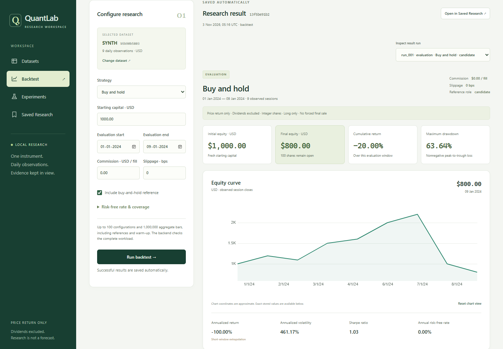
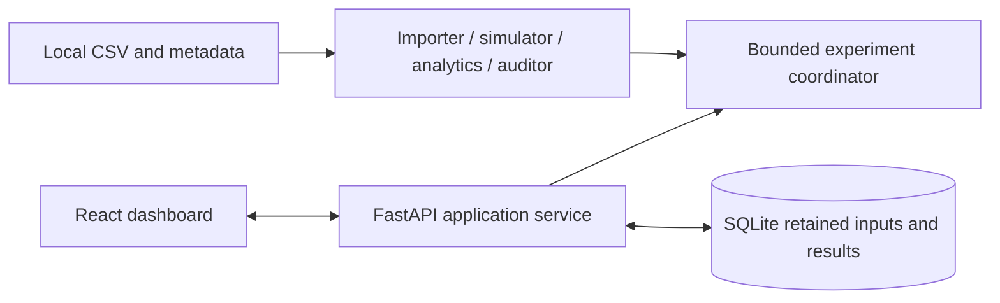

# QuantLab

QuantLab is a local strategy-research application that makes backtest timing,
accounting and data limitations inspectable. It combines a Python financial core,
a FastAPI/SQLite backend and a React/TypeScript dashboard. It is educational
research software, not a live-trading system or a market forecast.

## What it does

- Validates daily OHLCV CSV plus explicit provenance/adjustment metadata; rejects
  invalid rows instead of silently cleaning them and retains original inputs.
- Simulates buy and hold, SMA crossover and time-series momentum with close-only
  signals, next-observed-open execution, integer shares and explicit costs.
- Shows equity, returns, drawdown, volatility, Sharpe, trades, orders and audit
  findings, including undefined metrics and risks that remain unassessed.
- Compares bounded parameter grids, costs, subperiods and chronological train/test
  experiments with training-only selection and fresh test capital.
- Saves research in SQLite and freshly recomputes retained experiments, separating
  economic agreement from implementation identity.

## Screenshots

The application captures below use only the repository's **invented nine-session
SYNTH demo**, including nonmarket date labels. They illustrate software behavior,
not historical market performance. No private observations or personal paths
are shown.



[Mobile saved-research screenshot](docs/images/synthetic-mobile-research.png)
shows the frozen training-only choice and comparison controls.

## Stack and architecture

Python/Decimal, FastAPI, Pydantic and SQLite; React, TypeScript, Vite, Zod and
uPlot; pytest, Vitest/Testing Library and Playwright. No provider SDK or cloud
service is required. The core is independent of HTTP, persistence and the UI.



See [architecture](docs/ARCHITECTURE.md) and the [financial contracts](docs/DECISIONS.md).

For a source-grounded explanation of the whole project, use the
[complete handbook](docs/QUANTLAB_COMPLETE_HANDBOOK.md): 20 chapters covering
Python, finance, the engine, audits, experiments, storage, UI, tradeoffs and an
eight-week study plan. It distinguishes implemented behavior, recorded verification
and hypothetical improvements, with worked ledgers and interview exercises.

## Local development

Verified on Windows 11 with **CPython 3.15.0, Node 24.15.0/npm 11.12.1 and
Microsoft Edge**. Packaging declares Python 3.12+; Python 3.12 and other operating
systems/browsers have not been verified. Select an existing interpreter with
`py -0p`. Dependency installation needs package-registry access. No API key,
private dataset, personal configuration or existing database is needed.

From the cloned repository root in PowerShell:

```powershell
py -3.15 -m venv .venv
.\.venv\Scripts\python.exe -m pip install -e '.[test]'
.\.venv\Scripts\python.exe -m pip check
.\.venv\Scripts\python.exe -m quantlab.api
```

The backend binds to 127.0.0.1:8000 and creates ignored `data/quantlab.sqlite3`.
[API documentation](http://127.0.0.1:8000/docs) is available while it is running.
In a second PowerShell terminal, from the repository root:

```powershell
cd frontend
npm ci
npm run dev
```

Open [the dashboard](http://127.0.0.1:5173/). Vite proxies `/api` to the loopback
backend. Stop both terminals with Ctrl+C; preserve SQLite to retain research.
If those ports are occupied, use `python -m quantlab.api --port 8019` with the
venv interpreter; in the frontend terminal set
`$env:QUANTLAB_API_TARGET='http://127.0.0.1:8019'` and run
`npm run dev -- --port 5179 --strictPort`, then open port 5179.

In Datasets, choose **Load synthetic example**, inspect the declarations and
import it. Open Backtest; use buy and hold, $1,000 and zero costs. The synthetic
reference ends at **$800 with 100 shares still open**. Inspect audit evidence,
then open Saved Research and reproduce it. The [demo guide](docs/DEMO_GUIDE.md)
and [offline import guide](docs/OFFLINE_DATA_GUIDE.md) describe the full workflow.

## Testing and evidence

From the repository root:

```powershell
.\.venv\Scripts\python.exe -m pytest -q
.\.venv\Scripts\python.exe scripts/verify_repository.py
.\.venv\Scripts\python.exe scripts/check_publication.py
```

From `frontend`:

```powershell
npm test
npm run build
npm run test:e2e
```

The public backend suite has **444 synthetic/reference tests** plus **six
opt-in private real-data cases**, which explicitly skip when
`QUANTLAB_REAL_MARKET_DIR` is unset. It never downloads market data during tests.
The existing UI suite has 45 tests; four real-browser workflows use the actual
API/SQLite with synthetic inputs, including service restarts and reproduction.
On Windows the browser suite uses installed Edge. Other browser/interpreter
options are in the [dashboard contract](docs/DASHBOARD_CONTRACT.md).

Phases 0-10 and a later bounded historical-data validation are complete.
[Release verification](docs/RELEASE_VALIDATION.md),
[real-data verification](docs/REAL_MARKET_VALIDATION.md),
[publication readiness](docs/PUBLICATION_READINESS.md) and
[benchmark measurements](docs/BENCHMARKS.md) record actual commands/results and
failures. Benchmarks are local engineering measurements, not performance gains.
Implementation/verification are AI-assisted; independent owner mastery is not
inferred from passing tests.

## Real historical-data validation

In addition to the retained synthetic suite, private **Alpha Vantage
`TIME_SERIES_DAILY` public samples** verified **100 raw daily bars each for IBM
and MSFT, 2026-06-11 through 2026-11-02**. All three strategies, zero and nonzero
costs, source-backed audits, robustness, SQLite retention and fresh reproduction
were exercised; selected numerical outputs were independently cross-checked.

The underlying exchange feed was unspecified. IBM's interval split check
succeeded; MSFT's provider split query was unavailable and stayed unknown, while
separate Microsoft issuer history supported that interval's declaration.
These short samples do not verify long history, independent price accuracy,
session completeness, opening liquidity, profitability or predictive ability.
Returns exclude dividends. Exact sources, hashes, split evidence and limits are
in [REAL_MARKET_VALIDATION.md](docs/REAL_MARKET_VALIDATION.md).

**The IBM/MSFT observations, metadata/evidence archives and databases are private
and excluded from Git.** Redistribution permission was not established. A clone
can run the complete application and public tests with shipped synthetic inputs;
repeating the six private cases requires the original permitted local snapshot.
No product provider adapter, API-key workflow or live quotes were added.

## Limits and data rights

One instrument, daily USD bars, long-only integer shares, no leverage. No split,
dividend, tax, settlement-delay or delisting-proceeds processing. Final positions
remain open. Coverage, source truth, survivorship, significance and other audit
risks remain limited/unassessed. Short annualization is extrapolation. This is a
single-user loopback application, with no public-hosting/authentication claim.
The [known limitations](docs/KNOWN_LIMITATIONS.md) include the verified platform,
reproduction boundary and an unexplained historical disk-resource failure.

No license has been selected or added. No permission to redistribute third-party
market data is claimed. Do not add credentials, `.env` files, private databases,
market observations, environments or generated build/browser output to Git.

## Repository guide

| Location | Responsibility |
| --- | --- |
| `backend/src/quantlab/` | Independent research core plus application/API/SQLite boundaries |
| `backend/tests/` | Deterministic references, integration tests and opt-in private regressions |
| `frontend/src/`, `frontend/e2e/` | Dashboard, runtime schemas, component and browser verification |
| `frontend/public/examples/` | Invented CSV/metadata and an unknown-by-default local-file template |
| `docs/` | Contracts, architecture, evidence, limits and session/learning reports |
| `scripts/` | Read-only repository checks and repeatable engineering benchmarks |
| `data/raw/`, `data/processed/` | Ignored local observations; only empty placeholders are published |

Project memory: [charter](docs/PROJECT_CHARTER.md), [roadmap](docs/ROADMAP.md),
[status](docs/PROJECT_STATUS.md), [decisions](docs/DECISIONS.md).
