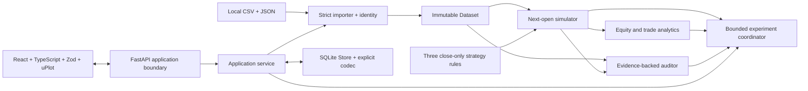
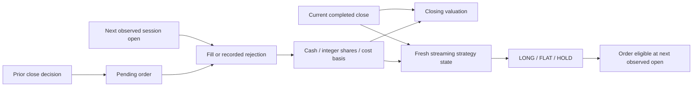

# QuantLab architecture

One local modular monolith: Python research core, SQLite/HTTP delivery boundary,
and a React client. There are no market-data adapters, background workers or
live-trading connections. Phase 9 delivered the validated offline alternative.

Arrows indicate data/coordination, not permission for the core to import HTTP
or persistence. `data`, `strategies`, `execution`, `analytics`, `audit` and
`experiments` remain independent of those delivery layers.

## Ingestion and identity

`frontend/src/pages/Datasets.tsx` decodes CSV strictly and submits its original
UTF-8 text plus raw metadata JSON through `api/client.ts`. Vite proxies local
same-origin `/api` requests; unrestricted CORS is not enabled. The HTTP boundary
rejects ambiguous/oversized JSON, and `application/service.py` delegates to
`data/loader.py` and `metadata.py`. Invalid rows produce bounded physical-row/
field diagnostics; no partial dataset is accepted.

Exact CSV bytes and canonical effective metadata determine SHA-256 identity.
Sorting/text normalization are reported separately. Import validity does not
grant simulation eligibility. SQLite retains original CSV bytes, effective
metadata and reports. Evidence files referenced in metadata remain the user's
responsibility. See [data](DATA_CONTRACT.md) and [offline](OFFLINE_DATA_GUIDE.md)
contracts for precise semantics.

## Signal, order, fill and portfolio state

`execution/engine.py` owns event order and accounting. Rules in
`strategies/rules.py` receive only the current completed close and position;
SMA/momentum rolling state is fresh per run. Fill prices use adverse slippage
and six-decimal half-up rounding; fees/notionals use cents. Budgeted integer
shares cannot create negative cash or leverage. Closing equity is cash plus
marked holdings. Final holdings stay open; terminal pending orders expire.
The [execution contract](EXECUTION_CONTRACT.md) owns all financial details.

`analytics/` derives existing price-return metrics and full-entry/full-exit
trade statistics; unavailable statistics retain reasons. `audit/` separately
folds the recorded ledger/costs, checks supported timing/input evidence and can
optionally replay. PASS is rule-scoped; unsupported risks stay NOT_ASSESSED.
The auditor does not independently certify every statistical formula.

## Experiments and retained research

`experiments/runner.py` validates and budgets configurations/periods/costs
before execution, then coordinates the same simulator, analytics and auditor.
Any invalid plan, computation failure or audit FAIL aborts the experiment.
Normal rejected orders remain inspectable simulation outcomes.

Training ranks only training candidates, freezes selection, then starts a
fresh flat test portfolio. Optional training-window indicator warm-up produces
no test cash, trades or performance observations. Benchmarks share periods,
capital and costs; unequal subperiods are not ranked as equivalent evidence.

`application/service.py` computes before saving a completed record. `Store`
uses explicit transactions, foreign keys, versioned schema and checksums;
failed writes roll back. Routes serialize Decimal/date/undefined metrics using
the existing codec, not a second financial engine. React formats original money
strings; canvas coordinates are approximate and exact values remain available.

## Reproduction

GET retrieves saved request/results. Empty-body POST reproduction reconstructs
the retained Dataset through the importer, revalidates the saved request and
executes the current coordinator. Economic outputs compare exactly under the
documented projection; implementation/source/runtime identity is separate.
No original source archive is restored and no replacement experiment is saved.
Details belong in [API_CONTRACT.md](API_CONTRACT.md).

Release tools under `scripts/` measure/check the existing application. They are
not production services. Validation evidence: [RELEASE_VALIDATION.md](RELEASE_VALIDATION.md).
