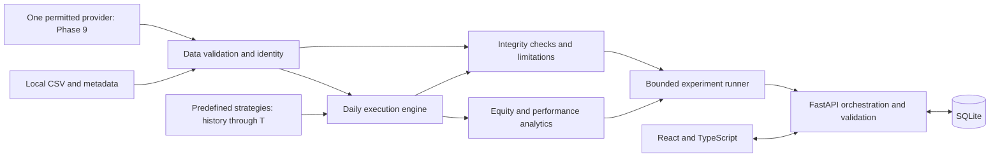

# QuantLab project charter

Established: 2026-11-01 (Asia/Calcutta). This document preserves the governing
scope and development protocol from the user's master specification. Detailed
contracts belong in [DECISIONS.md](DECISIONS.md); phase tracking belongs in
[ROADMAP.md](ROADMAP.md) and [PROJECT_STATUS.md](PROJECT_STATUS.md).

## Purpose and engineering objective

QuantLab will research predefined trading strategies against historical data,
simulate explicit execution assumptions, measure performance, audit supported
integrity risks, and compare controlled experiments through a web application.
The central question is whether apparent performance survives scrutiny of
inputs, accounting, timing, costs, and evaluation methodology.

Correctness, explainability, reproducibility, measurable engineering depth, and
progressive human understanding take priority over feature count or attractive
returns. The intended level is substantial but defensible by a third-year
undergraduate interviewing for fresher software engineering roles.

Every major technology needs a concrete requirement. Prefer the simplest design
that teaches the required engineering skill. Do not repeat the previous Fincore
Payments project's growth in complexity beyond the owner's understanding.

## Committed functional boundaries

- U.S.-listed stocks and ETFs; local historical daily OHLCV; one instrument per
  simulation; USD; long-only integer shares; no leverage, borrowing, or shorting.
- Buy and hold, simple moving-average crossover, and one precisely defined
  momentum strategy. No additional strategies without explicit authorization.
- Strategies decide after session T closes. Resulting market orders execute no
  earlier than the next available session's open. Strategy decisions receive
  only information available at that close.
- Cash, positions, orders, fills, costs, unfilled orders, and end-of-run treatment
  must have documented semantics before engine implementation.
- Data provenance, adjustment conventions, corporate-action limitations, missing
  session uncertainty, and simulation assumptions must remain visible.
- Metrics include equity, cumulative and annualized returns, drawdown,
  volatility, Sharpe ratio, trade statistics, and comparable buy-and-hold results.
  Each implemented metric needs definitions, edge cases, and reference tests.
- Controlled robustness experiments vary parameters, costs, and historical
  periods, with bounded resource use and honest in/out-of-sample separation.
- Persist relevant inputs, configurations, and results; expose REST APIs; provide
  a usable research interface once the engine is verified.
- Evaluate one permitted external data provider in Phase 9. If none is suitable,
  validate an offline workflow and document the limitation. No restricted
  scraping or reliance on undocumented endpoints.

OHLCV means open, high, low, close, and volume for a session, not an intraday
path. A signal is a strategy's desired action; an order is an execution
instruction; a fill is an actual simulated transaction. Equity is cash plus the
marked value of held shares. An experiment combines identified data, an
effective configuration, execution conventions, and versioned results.

## Integrity claims and limits

The auditor must distinguish these categories:

| Category | Examples | Required wording |
| --- | --- | --- |
| Automatically checkable | Duplicate dates, invalid OHLC values, non-finite input, recorded fill preceding its eligible session, negative cash | Report the checked rule and evidence; never imply wider coverage |
| Partly assessable | Look-ahead risk, gaps in sessions, adjustment consistency, parameter-selection leakage | Explain what inputs or instrumentation permit assessment and what remains unknown |
| Unresolved from available data | Universe survivorship/delistings, undisclosed provider revisions, complete corporate-action history, market liquidity at the open | State the limitation; do not claim detection or elimination |

Passing checks cannot establish that a strategy is profitable, reliable,
statistically significant, or predictive. Synthetic or incomplete data cannot
support real-market performance claims. No theoretical feature may be described
as implemented or tested.

## Non-goals and change control

Excluded: real-money or automated live trading; brokerage integration;
multi-asset portfolio management; derivatives; intraday or tick simulation;
price prediction; AI recommendations or chatbots; sentiment engines; arbitrary
executable user strategies; social features; billing; enterprise multi-tenancy;
distributed infrastructure; microservices; Kubernetes; Redis, Kafka, or Celery
without a demonstrated, explicitly approved requirement.

Market-event overlays, earnings studies, walk-forward testing, advanced
portfolios, more providers, and significance/uncertainty analysis are optional
post-MVP ideas, not committed work.

Before a major scope or architecture change, record the problem, why current
functionality is insufficient, benefits, added complexity, dependencies, roadmap
impact, and whether it is essential or optional. Wait for explicit approval.
Minor choices within an authorized phase may be resolved autonomously. Record
decision changes by dated supersession rather than silently changing history.

## Proposed architecture

Use a modular monolith: one Python backend with a separate React client.
These boxes describe responsibilities, not separate services or existing code.

The experiment runner orchestrates repeated engine, analytics, and audit calls;
the arrows show resulting data flow, not permission for those layers to import
the runner or API. Strategies return signals, not HTTP responses or database
records. The engine controls which history a strategy receives. Analytics are
pure functions where practical. Persistence and HTTP wrap the working core.

| Responsibility | Planned code location, created only when needed | First phase |
| --- | --- | --- |
| CSV, metadata, validation, fingerprints | `backend/src/quantlab/data/` | 1 |
| State, orders, fills, daily simulation | `backend/src/quantlab/execution/` | 2 |
| Buy-and-hold reference, then common strategy interface | `backend/src/quantlab/strategies/` | 2-3 |
| Returns, risk, trade statistics | `backend/src/quantlab/analytics/` | 4 |
| Supported checks and explicit limitations | `backend/src/quantlab/audit/` | 5 |
| Bounded variations and comparisons | `backend/src/quantlab/experiments/` | 6 |
| Schema, repositories, endpoints | `backend/src/quantlab/persistence/`, `api/` | 7 |
| Research interface | `frontend/src/` | 8 |
| One data adapter within the data responsibility | `backend/src/quantlab/data/` | 9 |

Preferred tools: Python 3.12 or verified compatible stable Python; pytest;
FastAPI and Pydantic at the HTTP boundary; SQLite initially; React and
TypeScript with one lightweight chart library selected in Phase 8. Use NumPy or
pandas only when they simplify work that actually exists. No ORM, migration
framework, task queue, or provider SDK is preselected. Use versioned SQL when
schema changes first become necessary. No dependencies are installed in Phase 0.

## Engineering acceptance and evidence

Each phase must satisfy its roadmap acceptance criteria, not merely start a
server. Core requirements are readable code, useful type hints, validated
external inputs, explicit expected errors, deterministic fixtures, separate
domain and delivery concerns, and documented financial invariants.

Important simulation invariants include nonnegative cash, nonnegative integer
shares, no fills before eligibility, fees accounted exactly once, and equity
equal to cash plus marked holdings. A dataset with invalid rows must not become
a successful import by silently discarding them.

Tests must establish behavior using handcrafted expected values and meaningful
edge cases. Unit, integration, reproducibility, and performance checks arrive
when the relevant functionality exists. Never fabricate tests, coverage,
throughput, returns, or latency. Establish a measured baseline before claiming
improvement; record interpreter, hardware, dataset size, configuration, command,
and timing method. Distinguish asymptotic reasoning from measured runtime.

## Session protocol and ownership

1. Read the charter, roadmap, status, decisions, and latest session report.
2. Identify the explicitly authorized phase; review inputs, outputs,
   dependencies, and acceptance. Explain approach and material tradeoffs.
3. Implement only that phase; add relevant tests; run available checks; fix
   in-scope failures. Split oversized phases into named subphases with a reason.
4. Write the next sequential permanent session report, update project memory,
   and stop. Never automatically start the next phase.

Use COMPLETE only when acceptance is met; otherwise use PARTIAL, or BLOCKED for
a genuine obstacle. Preserve work, record exactly what remains, and propose
the smallest continuation. A report number increases for every session,
including sessions that continue the same phase.

Every phase must build the owner's ability to explain key files, run tests,
make a small change, and recreate one or two key functions once code exists.
Reports must tie concepts to actual work. Clearly identify AI-assisted work;
do not claim the owner independently designed or coded it. The final release
and resume must describe demonstrated skills and supported evidence.

## Mandatory session report format

Create `docs/session-reports/SESSION_NN_PHASE_N.md`, beginning with Session 00.
Use these headings in order; adapt explanations to actual work and avoid
duplicating entire specification documents.

| Section | Required contents |
| --- | --- |
| A. Session overview | Number, phase, objective, COMPLETE/PARTIAL/BLOCKED, actual progress |
| B. What was implemented | Features or foundation, changes, files, important functions/classes/modules; explicitly say when none exist |
| C. Why this functionality exists | Problem, necessity, contribution to QuantLab |
| D. Integration with the existing codebase | Before/after, interactions, data flows, architectural effects |
| E. Technical concepts to study | Relevant concepts connected to actual files or implementation |
| F. Financial and quantitative concepts to study | Relevant assumptions, definitions, useful formulas/examples, and limits |
| G. Engineering decisions and tradeoffs | Considered/chosen approaches, rationale, alternatives, limitations |
| H. Testing and verification | Tests written, actual commands/results, edge cases, failures, unverified behavior |
| I. Complexity and performance | Relevant theoretical bounds, measurements/method, bottlenecks; distinguish unmeasured behavior |
| J. Interview preparation | Five technical questions, three finance questions when applicable, one independent exercise, key files to explain |
| K. Current project status | Completed/current/remaining phases, known bugs, limitations, technical debt |
| L. Next session | Exact task, prerequisites, acceptance criteria, decisions needing approval |

Phase 0 has no business code and no finance test results. Its acceptance is a
coherent, checked foundation ready for a small first implementation phase.
