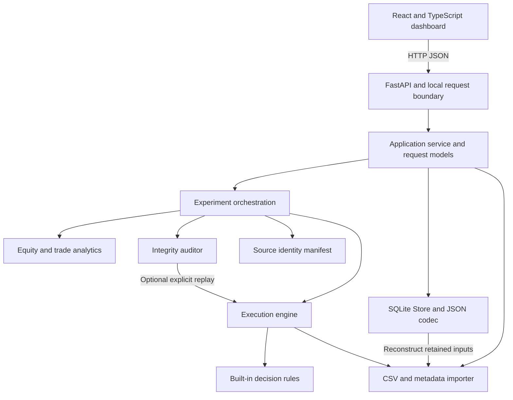
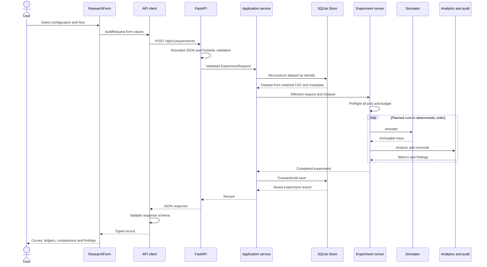
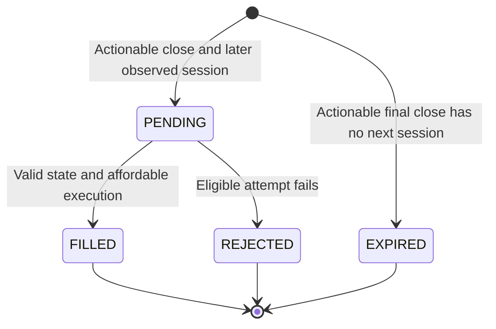

# QuantLab: The Complete Engineering and Quantitative Research Handbook

Version date: **2026-11-04**. Source baseline: completed Phases 0–10, subsequent
limited historical-data validation and publication preparation. This is an
educational companion to the existing implementation, not a new development phase.

This handbook is for a third-year Data Science student who knows basic programming
and data structures and wants to explain, calculate, debug and defend this project.
Read with a notebook and the source open. Predict a result before running it;
then explain any disagreement. Recognizing a function name is not mastery.

The project was developed and verified with AI assistance. This document does not
attribute independent implementation or understanding to its owner. The exercises
are opportunities to establish that understanding through independent work.

## How to use the evidence

- **Implemented** describes behavior found in the current source.
- **Tested** describes assertions in existing tests. A test establishes its
  particular case, not correctness for every possible input.
- **Recorded verification** means an earlier report records an executed check;
  those suites were not rerun merely to write this handbook.
- **Handbook verification** means source/reference checks and numerical examples
  checked during this documentation session.
- **General concept** explains transferable knowledge; it is not a claim that
  QuantLab implements the corresponding facility.
- **Hypothetical improvement** means an unimplemented option requiring a separate
  authorized task. Complexity estimates are reasoning, not measured capacity.

For actual behavior, source and tests take precedence over historical proposals.
The [decision log](DECISIONS.md) preserves earlier proposals and later amendments;
do not read an old proposed rule as the final implementation. Financial constraints
remain intentional: one instrument, daily USD bars, integer shares, long-only,
cash-funded trading, no leverage and no corporate-action processing.

## Contents

1. [Understanding QuantLab](#1-understanding-quantlab)
2. [Complete architecture](#2-complete-architecture)
3. [Python and software engineering foundations](#3-python-and-software-engineering-foundations)
4. [Financial markets from first principles](#4-financial-markets-from-first-principles)
5. [The historical-data pipeline](#5-the-historical-data-pipeline)
6. [The backtesting engine step by step](#6-the-backtesting-engine-step-by-step)
7. [Strategies and algorithms](#7-strategies-and-algorithms)
8. [Costs and performance mathematics](#8-costs-and-performance-mathematics)
9. [The integrity auditor](#9-the-integrity-auditor)
10. [Robustness and experiment design](#10-robustness-and-experiment-design)
11. [Databases and persistence](#11-databases-and-persistence)
12. [HTTP FastAPI and application services](#12-http-fastapi-and-application-services)
13. [React and frontend engineering](#13-react-and-frontend-engineering)
14. [Testing verification and benchmarks](#14-testing-verification-and-benchmarks)
15. [Scaling performance and concurrency](#15-scaling-performance-and-concurrency)
16. [Security and production readiness](#16-security-and-production-readiness)
17. [Design decisions and tradeoffs](#17-design-decisions-and-tradeoffs)
18. [Limitations and possible evolution](#18-limitations-and-possible-evolution)
19. [Interview defense](#19-interview-defense)
20. [Study roadmap glossary and source index](#20-study-roadmap-glossary-and-source-index)

## 1. Understanding QuantLab

### 1.1 The question the application can answer

QuantLab is a local research application for asking: **Given these daily prices,
this explicit rule, these execution assumptions and these costs, what ledger
would the simulation produce?** It also asks whether that ledger is internally
consistent and how its result changes across selected parameters, costs and dates.

A backtest replays historical observations through a rule. It is useful because
an idea such as “buy when the short average exceeds the long average” is ambiguous
until we decide when the information becomes available, which price executes an
order, how many shares are affordable and what happens at the end. Code forces
those decisions to become explicit and repeatable.

A profitable-looking curve can nevertheless come from an invalid experiment.
Perhaps the code uses the day's closing price to decide and also assumes it could
trade at that already-known price. Perhaps a split is mistaken for a price crash.
Perhaps the researcher tried 200 settings and shows only the best. Perhaps fees
were omitted or the data excludes failed companies. These are different problems:
correct arithmetic alone cannot solve all of them.

QuantLab therefore combines three responsibilities:

1. **Simulation:** generate decisions, orders, fills and daily account values
   using one documented model.
2. **Integrity auditing:** independently reconcile supported relationships and
   attach evidence to findings.
3. **Robustness experiments:** repeat the same engine under controlled changes
   and separate training selection from a later evaluation period.

The technical substance lies in these interactions: strict ingestion, exact money
conventions, causal event ordering, independently reconstructed accounting,
bounded experiment planning, retained input bytes, fresh reproduction and a UI
that presents actual backend results. There is no prediction model, broker link,
live trading, portfolio optimizer, multi-asset allocation or production hosting.

### 1.2 A mental model: a laboratory notebook with an executable ledger

Think of a dataset as a sealed input envelope, a request as the experiment recipe,
the engine as a chronological ledger writer, the auditor as a second accountant,
and SQLite as the notebook retaining the recipe and result. A hash identifies
the envelope's contents; it does not certify that its prices describe reality.

The interface has four main destinations. **Datasets** imports and inspects CSV
and metadata. **Backtest** runs one selected configuration. **Experiments** runs
parameter, cost, subperiod or train/test studies. **Saved Research** retrieves
earlier results and asks the current implementation to recompute them.

Data import and permission to simulate are separate gates. A well-formed file
with unknown split status can be stored and inspected, yet cannot be simulated.
That separation is useful: uncertainty stays visible instead of being repaired
by an optimistic default.

### 1.3 A complete experiment you can explain

Use the shipped [nine-session CSV](../frontend/public/examples/nine_sessions.csv)
and [metadata](../frontend/public/examples/nine_sessions.metadata.json). These are
invented observations labeled `SYNTH`, including dates that are not real exchange
sessions. They are a teaching fixture, not historical U.S. market data.

Import both files. The backend validates each row and metadata field, sorts the
bars, computes three identities and retains the original CSV bytes. In Backtest,
choose buy and hold, initial capital `$1,000`, commission `$0` and slippage `0`.
The first close is `$10`. The rule requests LONG, creating a cash-budget order.
The second observation opens at `$10`, so the engine buys 100 shares. At the final
close of `$8`, equity is `$800`: zero cash plus 100 × $8. The position remains open.
Cumulative return is `800 / 1000 - 1 = -0.20`, or −20%.

Inspect the order's decision date and later fill date, the cash debit, all nine
valuations, and the audit findings. An audit PASS for timing is compatible with
a financial loss. A WARNING about provenance is compatible with internally
correct accounting. Neither is a probability of future success.

Now run an experiment with momentum lookbacks 1 and 2, training on January 1–6
and testing on January 7–9 of this synthetic fixture. The candidate with lookback
2 wins training with 81%, yet its fresh test portfolio ends at `$460`, a −54%
return. Chapter 10 derives this deliberately uncomfortable example. It teaches
why parameter selection and evidence of generalization are different questions.

The application saves a completed experiment with its effective request, result,
dataset identity and implementation information. Reopening it reads saved data;
Reproduce performs a fresh computation from retained inputs. A successful
comparison concerns the recorded inputs and conventions. It is not a claim that
the original market source was correct or that an old software environment has
been restored.

### 1.4 The ownership standard

You should eventually be able to calculate a fill with pencil and paper, explain
why a signal did not create an order, locate a rejected input's validation layer,
reconstruct a cash discrepancy and describe one limitation without prompting.
The study plan builds these abilities before asking you to discuss distributed
systems. Learning the application is more valuable than memorizing an ambitious
list of technologies it does not use.

## 2. Complete architecture

### 2.1 What a modular monolith means here

A monolith deploys related application responsibilities together. “Modular” means
the code still has explicit internal boundaries. QuantLab runs one backend
application with a separate browser frontend; its research modules are Python
modules, not independently deployed network services.

The core understands bars, rules, money and research results. It does not need to
know HTTP status codes, React state or SQLite connections. The application layer
coordinates a user operation: retrieve a dataset, run research and retain the
result. The delivery layer converts HTTP/JSON to validated requests. Persistence
handles durable representation. These are distinctions of responsibility, not
claims that every function is pure or every layer has an abstract interface.



An arrow means “uses,” not “sends to another server.” The core's independence is
checked by `scripts/verify_repository.py`, which examines 29 core modules for
forbidden delivery/persistence imports. The full backend package has 41 Python
files in the verified baseline. File counts do not measure design quality, but
the import-direction check prevents a specific class of architectural drift.

### 2.2 Where responsibilities live

| Repository location | Responsibility and important entry point |
| --- | --- |
| [data/loader.py](../backend/src/quantlab/data/loader.py) | `load_dataset` / `load_dataset_bytes`: validated immutable dataset or structured failure |
| [strategies/rules.py](../backend/src/quantlab/strategies/rules.py) | `create_rule`: fresh stateful rule from a supported immutable configuration |
| [execution/engine.py](../backend/src/quantlab/execution/engine.py) | `simulate`: chronological execution and accounting |
| [analytics/benchmark.py](../backend/src/quantlab/analytics/benchmark.py) | `analyze_simulation`: equity and trade interpretation of a completed trace |
| [audit/auditor.py](../backend/src/quantlab/audit/auditor.py) | `audit_simulation`: evidence-scoped findings and optional replay |
| [experiments/runner.py](../backend/src/quantlab/experiments/runner.py) | `run_experiment`, `run_train_test`: plan and execute bounded studies |
| [application/service.py](../backend/src/quantlab/application/service.py) | Import, execute, retrieve and reproduce use cases |
| [persistence/store.py](../backend/src/quantlab/persistence/store.py) | `Store`: connections, transactions and records |
| [api/app.py](../backend/src/quantlab/api/app.py) | `create_app`: configure routes, dependencies and error translation |
| [frontend/src/App.tsx](../frontend/src/App.tsx) | Application navigation and selected dataset |
| [frontend/src/api/client.ts](../frontend/src/api/client.ts) | HTTP calls and runtime response validation |

Domain logic answers “how should an order affect cash?” Application logic answers
“which retained dataset should this request use, and when should its completed
result be saved?” Mixing them would make a financial test require a database and
would encourage API handlers to become a second financial engine.

### 2.3 Trace a research request across every boundary



`ResearchForm` in [Research.tsx](../frontend/src/pages/Research.tsx) owns editable
inputs and submission state. `buildRequest` in
[research.ts](../frontend/src/lib/research.ts) converts strings into the API's
request shape. This is boundary formatting, not trade calculation. The client
posts JSON. `LocalBoundary` first limits and validates the HTTP body; Pydantic
then validates the request's schema and types.

The service reconstructs the dataset through the same importer used originally.
The runner validates every planned combination before trading begins. Each run
uses `simulate`, then `analyze_simulation` and `audit_simulation`. Only a complete
successful experiment reaches the save transaction. A normal rejected order is
a valid modeled outcome; an invalid experiment or audit FAIL aborts the request.

After the response, Zod checks its runtime shape. TypeScript alone cannot validate
bytes received over a network. `ResultView` renders the backend's selected runs,
financial strings and findings. The chart converts equity to JavaScript numbers
for coordinates, while exact reported monetary values remain strings for display.

### 2.4 Why this structure fits, and where it costs

A modular monolith keeps debugging local: one request can be stepped through from
service to engine without message brokers, distributed traces or cross-service
version negotiation. Tests can call the core directly. SQLite avoids a separately
operated database server. For a small local research tool, these are concrete
reductions in operational and conceptual complexity.

The tradeoff is a shared backend failure/resource boundary. CPU-heavy runs compete
inside the same deployment, and releases cannot independently scale only the
auditor. That does not establish a current defect; it defines where growth may
create pressure. A background worker would be justified by measured long-running
jobs and cancellation needs. Separate services would require stronger reasons,
such as independent ownership or isolation requirements, after simpler boundaries
have proved insufficient. Neither is currently implemented.

## 3. Python and software engineering foundations

### 3.1 Types describe intent; validation enforces a boundary

A type hint tells a reader and tooling what values a function expects. Python does
not automatically reject every incorrectly typed call. For example, annotating
`quantity: int` does not stop a caller from passing a string. QuantLab therefore
combines annotations with explicit validation at boundaries and model construction.

Teaching example:

```python
def position_value(quantity: int, price: Decimal) -> Decimal:
    if type(quantity) is not int or quantity < 0:
        raise ValueError("Expected a nonnegative integer quantity")
    return quantity * price
```

This small illustrative function is not a production symbol. The relevant real
checks are in `execution/engine.py` and `strategies/models.py`. The exact-type test
matters because Python's `bool` is a subclass of `int`: `isinstance(True, int)` is
true, but a strategy window of `True` is not a meaningful research request.

Union annotations such as `date | None` express optionality. `Literal["LONG",
"FLAT", "HOLD"]` documents a finite vocabulary. The current domain uses Literal
strings for targets and statuses, rather than an Enum class for each state. An
Enum groups named values into a runtime type; it can improve discoverability but
requires explicit wire conversion. The persistence codec supports `Enum.value`,
and a test exercises that support; this does not mean the trading states are Enums.

### 3.2 Dataclasses, identity and controlled mutation

A dataclass generates ordinary record conveniences such as initialization and
field-based equality. `@dataclass(frozen=True)` prevents ordinary field reassignment.
`Bar`, `ExecutionSettings`, `Order`, `Fill`, `SimulationResult` and strategy
configurations are examples. They group related facts into explicit types instead
of relying on undocumented dictionary keys.

```python
from dataclasses import replace
from decimal import Decimal
from quantlab.execution import ExecutionSettings

base = ExecutionSettings()
costly = replace(base, commission_per_fill_usd=Decimal("1.00"))
assert base.commission_per_fill_usd == Decimal("0.00")
```

This uses real public models. `replace` creates another value; it does not mutate
`base`. Equality asks whether values match; identity (`a is b`) asks whether two
names refer to the same object. With a mutable list, `b = a` creates another
reference, not a copy. Appending through either name changes the shared list.
Frozen records are also only shallowly immutable if they contain mutable children;
QuantLab commonly uses tuples of frozen records to strengthen the boundary.

The engine still needs evolving state. Its local cash, shares and lists change
while it computes. It replaces a pending immutable `Order` with its terminal
record and finally returns tuples. Each simulation creates a fresh rule, so the
SMA deque from one run is not intentionally shared with another. Immutability at
interfaces and mutation inside a bounded calculation work together.

### 3.3 Choose a collection for the operation

| Structure | Mental model and example | QuantLab use and tradeoff |
| --- | --- | --- |
| List | Ordered mutable sequence: append a valuation | Engine builds traces efficiently; append is amortized O(1), copying prefixes repeatedly would be expensive |
| Tuple | Fixed sequence: `(open, close)` | Returned traces/configurations resist accidental edits; changing them creates another sequence |
| Dictionary | Key to value: `fills_by_order[7]` | Auditor indexes matching records; average O(1) lookup, memory proportional to indexed records |
| Set | Unique membership: `date in seen_dates` | Duplicate dates/configurations; iteration order is not a research ranking |
| Deque | Efficient removal from the front and append at the back | Rolling SMA/momentum observations; avoids O(window) list shifting |

Hash-based collection complexity is an average-case model, not a constant-time
guarantee for arbitrary adversarial keys. Financial integer and Decimal operations
also depend on operand size. QuantLab constrains numeric inputs, making the usual
bounded-number complexity model useful and explicit.

### 3.4 Functions, classes and interfaces

A pure function's result depends on its arguments and it has no externally visible
side effects. Cost calculation and canonical JSON encoding are close examples.
Purity makes a hand-calculated assertion straightforward. `simulate` constructs
local mutable state but returns a deterministic value for the same validated
inputs and conventions; it does not write a database or call a provider.

A class is useful when related operations share state or identity. An SMA rule
holds its deques and sums; `Store` owns a database path and methods. This does not
justify inventing a framework for every two-line calculation. Functions remain
the simpler representation when there is no ongoing state to encapsulate.

`DecisionRule` in [strategies/rules.py](../backend/src/quantlab/strategies/rules.py)
is a `Protocol`: a structural interface describing `on_close(session, close,
shares) -> Target`. The engine depends on that small operation. `create_rule`
accepts only the three supported configuration types, so the interface is not a
public arbitrary-code strategy plugin. A new rule would require authorized code,
validation, tests and financial review.

### 3.5 Exceptions and atomic validation

An exception separates a failed operation from an ordinary result. Returning a
half-valid dataset with an error string would allow downstream code to overlook
the failure. `DataValidationError`, `SimulationError`, `AnalyticsError`,
`ExperimentError` and storage errors define distinct failure boundaries.

`Diagnostics` in [data/errors.py](../backend/src/quantlab/data/errors.py) counts
encountered issues and retains at most 100 details. `raise_if_invalid` prevents
publication of a partial Dataset. This is atomic validation: all accepted output
belongs to a successful import. It is not a promise to enumerate every imaginable
error after malformed CSV makes further parsing impossible.

At the HTTP boundary, known exceptions become appropriate structured responses.
Unexpected exceptions become a generic server error instead of a traceback
containing local paths. Inside a database transaction, catching `BaseException`
ensures rollback is attempted even for interruption-like failures; that broad
catch is followed by re-raising, not silently swallowing the event.

### 3.6 Iteration, sorting and searching

An iterator produces items one at a time. A generator is a convenient way to build
one using `yield` or a generator expression. `sum(value for value in values)` can
avoid a temporary list, but it does not make the original `values` disappear.
Similarly, using `csv.reader` does not make QuantLab a constant-memory importer:
the source bytes, decoded text and validated bars are retained during processing.

Sorting bars by date costs O(N log N) in the general case. A set detects duplicate
dates while reading; sorting alone would put duplicates together but would still
need a separate check. Strategy configurations are canonically sorted so a user's
input ordering or set iteration does not accidentally decide ties. A hash lookup
and a binary search solve different problems: the former finds an exact key;
the latter can find boundaries in sorted data. The engine currently scans bars
to validate/select windows; do not claim an unimplemented binary-search optimization.

### 3.7 Decimal, dates and serialization

Binary floating point cannot represent every decimal fraction exactly. Decimal
constructed from a string preserves the requested base-ten value:
`Decimal("0.1")` differs in intent from `Decimal(0.1)`, which imports the binary
float's approximation. Decimal still has precision and rounding rules; it is
not automatically infinitely precise. The engine uses its own precision-28,
ROUND_HALF_UP context, six decimal places for effective prices and cents for
cash notional/fees. Chapter 8 explains why statistical outputs use finite floats.

Daily sessions use `datetime.date`, not timestamps guessed from local browser
time. A session label remains the same date in India and New York. Metadata names
`America/New_York`, but the engine does not generate an exchange calendar. Saved
record creation timestamps are UTC; they describe storage events, not market bars.

JSON supports strings, numbers, arrays, objects, booleans and null, but has no
native Decimal or date type. `to_wire` in
[persistence/codec.py](../backend/src/quantlab/persistence/codec.py) converts
Decimal to a string, dates to ISO strings, dataclasses to objects and tuples to
arrays. Nonfinite values and unsupported objects are rejected. This makes missing
metrics explicit instead of serializing nonstandard NaN.

Canonical JSON sorts keys and removes irrelevant separator whitespace. SHA-256
maps bytes to a 256-bit digest represented here by 64 hexadecimal characters.
Changing bytes normally changes the digest. Hashing is not encryption: it does
not hide the original data, prove licensing, authenticate a publisher or repair
a corrupted source. Canonicalization defines which representation differences
matter; Chapter 5 shows the distinction between original CSV and metadata identity.

### 3.8 Determinism, state machines and invariants

Determinism means the same defined inputs and implementation produce the same
defined result. It requires more than avoiding random numbers: ordering, Decimal
context, warm-up boundaries, ties and serialization must also be specified.
Experiment IDs and storage timestamps may differ between new requests while
their economic calculations agree. Reproduction compares an explicitly selected
projection and implementation identity separately.

A state machine specifies allowed transitions. A pending order can become
FILLED, REJECTED or EXPIRED; it does not remain indefinitely eligible for every
later bar. An invariant is a relationship required throughout execution, such as
nonnegative cash, integer nonnegative shares, and `equity = cash + shares × close`.
Assertions against these relationships are stronger than checking only a final
return, because an incorrect intermediate state can accidentally produce the
right final number.

### 3.9 Complexity, memory and dependency discipline

Use N for imported bars, M for evaluated bars, W for warm-up bars and R for runs.
O(N) describes growth with input size, not “N milliseconds.” The engine validates
the imported structure and processes consumed bars, approximately O(N + W + M).
Its trace memory is O(M), even though rolling strategy state is bounded by a window.
Keeping every trace makes results inspectable but becomes expensive across grids.

Dependencies are external packages required to build or run the application.
Python direct requirements are pinned in [pyproject.toml](../pyproject.toml);
frontend versions and transitive resolution are captured in
[package.json](../frontend/package.json) and its lockfile. Pins support repeatable
installation but do not prove security or immortal registry availability. The
core avoids HTTP/persistence packages; adding pandas, a queue or an ORM would
create learning and maintenance costs that require a concrete benefit.

Tests use fixtures: controlled inputs whose expected behavior is known. A small
synthetic fixture can deliberately isolate a zero-volume rejection or one-cent
rounding edge. A large realistic dataset can exercise integration, yet hide why
a number is wrong. Both are useful when their evidence is described accurately.

## 4. Financial markets from first principles

### 4.1 What the instrument and the bar represent

A stock represents an ownership interest in a company. An exchange-traded fund
(ETF) is a fund whose shares trade on an exchange and whose portfolio can hold
many assets. QuantLab can model one eligible stock or ETF price series per run;
it does not look through an ETF into its holdings or combine several instruments.

An exchange organizes trading under market rules. A trading session is a period
of market activity associated with a date. An instrument's listing venue is not
necessarily the source of every observation in a vendor's feed. A consolidated
feed, a single venue feed and a vendor-defined daily bar can differ. For the
IBM/MSFT validation, listing venues were documented, but the underlying feed was
unspecified. Do not silently replace “listed on NYSE” with “NYSE-only prices.”

OHLCV summarizes a time interval: **open**, **high**, **low**, **close**, **volume**.
Suppose a daily bar is `(100, 106, 98, 104, 200000)`. The opening observation is
$100, the highest is $106, the lowest $98, the closing observation $104, and the
reported volume 200,000 shares. A candlestick visualizes the open/close body and
high/low range. It does not reveal the complete path within the day: the high
could have occurred before or after the low.

QuantLab uses the next observed bar's open for attempted execution and the current
bar's close for valuation and decisions. High and low are validated but are not
used to reconstruct intraday fills. A daily high does not establish that an
arbitrarily large order could have executed there. The source's aggregation
conventions still matter even when all OHLC inequalities are satisfied.

### 4.2 Orders, volume and actual execution

A market order asks a broker to execute at available market prices, without a
guaranteed limit price. QuantLab's next-open fill is an approximation of an
execution opportunity, not an actual submitted order or an opening-auction model.
There are no broker acknowledgements, partial fills, queue priority or connectivity
failures. A modeled order attempts once on its eligible observed session.

Volume is the amount reported traded over the bar. Liquidity is the ability to
trade a desired quantity promptly with limited price disturbance. These are
related but different. A day may report one million shares while only a small
quantity was available near the opening price. QuantLab rejects a fill on a
zero-volume bar. For positive volume, it does not cap quantity by participation
or verify opening depth. Positive volume therefore does not prove executable
liquidity, and a large simulated quantity can exceed the day's volume.

The bid is a price at which someone offers to buy; the ask is a price at which
someone offers to sell. With bid $99.95 and ask $100.05, the spread is $0.10. Buying
at the ask and immediately selling at the bid loses $0.10 per share before fees.
Market impact is the price movement caused by the order itself, such as a large
buy consuming increasingly expensive offers. Slippage is a difference between
a reference price and the realized execution price. QuantLab applies a configured
adverse percentage to the open; it does not separately estimate spread and impact.
If those effects are already embedded in an assumed slippage number, adding them
again in an external comparison could double-count costs.

A commission is a charged fee. Here it is a fixed USD amount per successful fill,
rounded to cents, not a broker-specific per-share or tiered schedule. A rejected
or expired order incurs no modeled fee. A 10-basis-point slippage setting means
0.10%: a $100 buy reference becomes $100.10 before price rounding.

### 4.3 Positions, cash and wealth

Going long means owning shares and benefiting when their price rises. Short
selling involves selling borrowed shares with an obligation to return them; it
introduces borrow availability, financing and potentially unbounded loss. QuantLab
supports long-only positions. Cash cannot be borrowed and shares cannot be negative.

Integer shares are whole units. Fractional shares allow values such as 2.5 shares.
With $100 and a $30 fill price, integer sizing buys 3 shares and leaves $10;
fractional sizing could spend all $100 before costs. QuantLab intentionally leaves
residual cash. Integer thresholds can make a small cost change alter quantity by
one whole share and change the subsequent trade path.

Cash is uninvested money. Holdings are the owned quantity. Mark-to-market means
valuing those holdings at a selected market reference, here the daily close:

`market_value_t = shares_t × close_t`

`equity_t = cash_t + market_value_t`

If cash is $10, shares 3 and close $32, equity is $106. That is an account valuation,
not a promise that all shares can be sold immediately at $32. There are no modeled
deposits, withdrawals, cash interest, taxes or settlement delays.

Cost basis is the recorded entry debit, including the entry fee. If three shares
cost $90 plus a $1 fee, basis is $91. At a $32 close the market value is $96 and
unrealized P&L is $5. If the eventual net sale credit is $95, realized P&L becomes
$4. QuantLab's full-entry/full-exit model avoids partial-lot allocation, but it
still distinguishes realized and unrealized gains. An open final position has
no invented exit fee or final liquidation fill.

### 4.4 Corporate actions and adjustment bases

A corporate action changes the economic interpretation of a security or position.
A two-for-one split turns 10 shares at roughly $100 into 20 at roughly $50, leaving
roughly $1,000 of value before unrelated price moves. A simulator that retains
10 shares while reading the new raw $50 price falsely reports a 50% loss.

A cash dividend transfers value to shareholders. Ignoring tax and other movement,
a $100 stock distributing $2 might trade near $98 afterward while the shareholder
has $98 of stock and $2 cash. A price-return calculation reports −2%; a total-return
calculation includes the distribution and, depending on its convention, reinvestment.
QuantLab excludes dividends and reports price-return economics.

Unadjusted prices retain the vendor's historical quoted values. Split-adjusted
prices rescale older prices to remove split discontinuities. Total-return-adjusted
series can also incorporate distributions according to provider methodology.
Mixing adjusted close with raw open/high/low is not one coherent price basis.
Rescaling price without an appropriate volume convention creates another mismatch.

The importer can describe several adjustment states; the engine's D04 eligibility
gate accepts only explicitly unadjusted, consistent OHLC, raw-volume inputs with
an interval declaration of no reported splits and nonempty evidence. It does not
process splits or permit the user to dismiss them with a coverage checkbox.
An adjusted dataset might be useful in another engine, but supporting it here
would require a new reviewed accounting contract, not relabeling the metadata.

### 4.5 Bias, calendars and assumptions

Look-ahead bias uses information unavailable at the decision time. Buying at
today's open because today's close will be high is an obvious example. More
subtle leakage can enter through revised datasets or selecting parameters after
seeing test results. QuantLab enforces a close-decision/next-observed-open sequence
and controlled train/test selection. Those mechanisms do not prove that upstream
data was available historically or that a researcher never inspected the test set.

Survivorship bias occurs when the dataset includes surviving securities but omits
failed or delisted ones. Selecting two familiar companies today is not a
historically representative universe study. A single-instrument tool cannot
infer missing companies from the bars it receives.

A calendar gap is a difference between dates. A missing exchange session requires
knowledge of an authoritative calendar and the source's session convention. A
Friday-to-Monday gap may be normal; a missing Tuesday may not be. QuantLab reports
calendar gaps without asserting which sessions were missing. It never inserts a
synthetic price to fill a gap. Local-file simulation requires acknowledgement of
unverified coverage even if metadata declares complete coverage.

Historical quality also includes corrections, duplicate bars, timezone labels,
bad OHLC relationships and wrong symbols. Syntax checks catch some faults; they
cannot prove that a plausible `$104` close should actually have been `$103.98`.
Every backtest is conditional on input quality and execution assumptions. The
right interview claim is “the implementation matches these checked conventions,”
not “historical simulation is equivalent to brokerage execution.”

## 5. The historical-data pipeline

### 5.1 Two files with different jobs

The CSV contains observations. The metadata JSON describes their interpretation
and provenance. The exact CSV header is:

```csv
date,open,high,low,close,volume
2024-01-02,10,12,10,12,100
```

Required metadata fields are `contract_version`, `symbol`, `exchange`, `currency`,
`frequency`, `session_timezone`, `source_kind`, `source_name` and
`adjustment_basis`. Version is integer 1; currency USD, frequency `1d` and timezone
`America/New_York` are constrained. Optional provenance/eligibility fields are
`source_reference`, `usage_note`, `ohlc_basis_consistent`, `volume_basis`,
`split_status`, `split_evidence` and `session_coverage`. Their default is explicit
unknown, not a favorable inferred value. An explicit false OHLC consistency claim
is rejected as contradictory input.

The real definitions are in [data/models.py](../backend/src/quantlab/data/models.py)
and the parser is [data/metadata.py](../backend/src/quantlab/data/metadata.py).
`parse_metadata(bytes, diagnostics)` returns a `Metadata` or no valid model while
recording issues. It rejects unknown keys, duplicate keys, non-object JSON,
nonstandard constants, missing fields and wrong types. JSON `true` is not accepted
as integer contract version 1. This strictness catches misspellings that a
permissive dictionary would silently ignore.

### 5.2 Follow one row through the importer

`load_dataset(csv_path, metadata_path)` reads files; `load_dataset_bytes(csv_bytes,
metadata_bytes)` accepts already supplied bytes. Both in
[data/loader.py](../backend/src/quantlab/data/loader.py) share `_build_dataset`.
They return a `Dataset` containing immutable bars, effective metadata and a report,
or raise `DataValidationError`. There is no successful partial Dataset.

Consider a row with surrounding spaces: `2024-01-02, 10 ,12,10,12,100`.

1. The CSV bytes are bounded at 10 MiB. The path loader reads at most limit + 1
   bytes so it can detect overflow without reading an unlimited file.
2. UTF-8 decoding accepts an optional BOM. Strict CSV parsing respects quoting
   and records the physical starting line for diagnostics.
3. The header must match the six columns in the specified order. A blank row,
   wrong field count or malformed quote is an error, not an observation to discard.
4. Surrounding field whitespace is trimmed and counted as normalization. The date
   must match ASCII `YYYY-MM-DD` and be a real calendar date.
5. Prices must be positive plain decimal text. Exponents, signs, `.5`, `1.`, NaN
   and Infinity are rejected. At most six meaningful fractional places are
   supported; insignificant trailing zeros do not create extra precision.
6. Volume must be an ASCII nonnegative integer. Zero remains a valid observation
   with a warning; it is not silently removed.
7. OHLC must satisfy `low <= min(open, close) <= max(open, close) <= high`.
   Here 10 <= 10 <= 12 <= 12, so the relationship holds.
8. Duplicate dates are rejected, even when another field on the duplicate row is
   invalid. Accepted rows are sorted by date while retaining their source rows.
9. Only after all required validation succeeds are the Dataset and report returned.

The resulting price `Decimal("10")` is a number with an explicit decimal
representation, and the `Bar.source_row` is evidence about the original file.
An unordered but otherwise valid file is accepted with reordering disclosed.
Reordering is not interpolation, resampling or price repair.

### 5.3 Failure examples teach the contract

| Input | Outcome and reason |
| --- | --- |
| `2024-02-30` | Invalid calendar date |
| Close 12, high 11 | Contradictory OHLC; entire import fails |
| Two rows for one date | Duplicate session; no arbitrary “keep last” |
| Empty volume | Missing/invalid integer; no zero substitution |
| Volume 0 | Row retained; later eligible order is rejected on that bar |
| `1e2` as price | Disallowed numeric spelling, despite a mathematical value of 100 |
| Unknown split status | Can be represented/imported; simulation remains ineligible |
| Metadata key repeated | Rejected, rather than accepting the last value |

The application limits metadata to 64 KiB and the HTTP import envelope to 12 MiB;
the reusable core metadata parser itself does not impose that application size
limit. Python's ordinary CSV field and integer-string limits are not globally
increased. These layered bounds should not be conflated with financial eligibility.

### 5.4 Identity is a defined equivalence relation

`fingerprints` in [data/identity.py](../backend/src/quantlab/data/identity.py)
receives the original CSV bytes and effective `Metadata`, and returns source,
metadata and dataset SHA-256 strings. `canonical_json` uses UTF-8, sorted keys,
compact separators and disallows nonfinite values.

Conceptually:

```text
source_hash = SHA256(original_csv_bytes)
metadata_hash = SHA256(canonical_json(effective_metadata))
dataset_id = SHA256(canonical_json({
    contract_version, source_sha256, metadata_sha256
}))
```

Changing CSV line endings, BOM, order or numeric spelling changes the source hash,
even if normalized bars are economically identical. Changing metadata indentation
or key order does not change the effective metadata hash. Omitting an optional
field and explicitly setting its default unknown value have the same effective
meaning. Paths and import timestamps are not part of dataset identity.

This is deliberate: the system can identify the exact original observation file
without making identities depend on a user's home directory. It also means
“same bars” and “same dataset ID” are different statements. A digest is evidence
of byte correspondence under the hash convention, not independent source truth.

### 5.5 Provenance and simulation eligibility

Provenance describes where observations came from and under what stated basis.
The report stores byte count, row count, range, hashes, normalization, zero-volume
dates, calendar gaps and warnings. Coverage assessment remains unverified. A
metadata declaration cannot establish trading-session completeness by itself.

`_preflight` in [execution/engine.py](../backend/src/quantlab/execution/engine.py)
requires unadjusted OHLC, explicitly consistent basis, raw volume, `none_reported`
split status and usable split evidence. For local files it also requires
`acknowledge_unverified_coverage=True`. Unknown or present splits cannot be bypassed
by selecting a smaller execution window inside an imported dataset whose
eligibility declaration remains unsuitable. A separately justified dataset/window
would need its own accurate metadata and evidence.

### 5.6 Complexity and alternatives

For B bytes and N rows, decoding/parsing/hashing is O(B), general sorting O(N log N),
and validation/index construction O(N). Memory is O(B + N), with multiple bounded
representations temporarily alive. This is appropriate for the current 10 MiB
daily-data scope, not a claim of streaming billion-row ingestion.

Standard-library parsing makes exact error rules and physical row reporting
explicit without adding a dataframe dependency. pandas would provide convenient
analysis and vectorized transformations, but its inference and missing-value
defaults would need careful control to preserve this contract. Polars offers
columnar and lazy execution options, but would still require deliberate schema,
Decimal and provenance semantics. Database-backed ingestion could query large
histories efficiently but adds staging/transaction/schema concerns. These are
alternatives, not hidden components of the current importer. Optimization should
preserve evidence and failure semantics before claiming speed improvements.

## 6. The backtesting engine step by step

### 6.1 A signal is a target, an order is an intent, a fill changes money

The rule produces `LONG`, `FLAT` or `HOLD` at a close. LONG means desire a long
position; FLAT means desire no position; HOLD means leave the current state alone.
LONG while already long does not buy more. FLAT while already flat does not sell.
The engine translates an actionable target into an `Order`.

A buy order records the available cash budget at decision time. It does not know
the future open or fix the quantity using tomorrow's price. A sell order requests
the entire current integer holding. A `Fill` records a successful execution with
quantity, reference open, effective price, notional, fee and cash change. Only a
fill changes cash and holdings. This separation lets an auditor distinguish an
unfulfilled intention from an actual modeled transaction.

The records are defined in
[execution/models.py](../backend/src/quantlab/execution/models.py). `Decision`
retains target and state at the close; `DailyValuation` retains close, market
value, basis and both P&L components; `SimulationResult` combines the full trace
with settings, identity, warnings and warm-up disclosure.

### 6.2 Preconditions are part of the financial model

`simulate(dataset, initial_capital, strategy, settings=None)` in
[execution/engine.py](../backend/src/quantlab/execution/engine.py) returns a
`SimulationResult` or raises `SimulationError`. Its preflight validates types,
supported finite monetary ranges, data structure, date order, metadata eligibility
and the consumed OHLC observations. At least two evaluation bars are required.
Dates are inclusive bounds; requested bounds need not themselves be observed
sessions. Reported result endpoints are the actual selected observations.

The supported initial capital maximum is `$999,999,999.99`; consumed prices range
from `$0.000001` through `$999,999.999999`. Shares and runtime cash also have
explicit large caps. These bounds support predictable Decimal arithmetic, not
claims that such positions are liquid. `validate_simulation_request` performs
the same request preflight without trading and returns evaluated/warm-up counts
for experiment budgeting.

Warm-up bounds, when supplied directly to the engine, must be paired, ordered,
nonempty and strictly before an explicit evaluation start. The rule receives
those closes with zero shares; its targets are discarded. Warm-up creates no
orders, holdings, fees or valuations. History in a gap between the requested
warm-up interval and evaluation is not implicitly consumed.

### 6.3 The event loop in the order it actually runs

For every evaluation bar, the loop performs these steps:

1. Attempt the previous close's pending order at this bar's open. Its eligible
   session must be this date and strictly later than its decision date.
2. Replace the pending record with its filled or rejected terminal record.
   Apply cash, shares, basis and realized P&L only if a fill exists.
3. Check supported portfolio invariants.
4. Value the position at this bar's close and append a daily valuation.
5. Call the rule with this close and the actual current shares. Record its target.
6. If the target requires a position change, create an order eligible at the next
   observed evaluation bar. If there is no next bar, immediately record EXPIRED
   with `end_of_window` and no attempted price or fill.

There is no forced final sale. A final valuation is not a fill. A last-close signal
cannot execute earlier in the same bar merely because its close is available in
the dataset. Processing the rows sequentially is necessary but not sufficient
for causality; which fields are exposed at each step also matters. Built-in rules
receive closes one at a time rather than the entire future array.



This depicts the returned lifecycle. Final-close orders are created already
expired rather than waiting for an imaginary later event. A rejected order is
not carried forward. A still-flat buy-and-hold rule can create a new order at
the rejection day's close, with a new ID and a new eligible date.

### 6.4 Buy sizing and cash arithmetic

`_execute(order, bar, cash, shares, settings)` is the engine's execution helper.
It returns a terminal `Order` and either a `Fill` or `None`. For a buy, it first
requires flat holdings and a valid cash budget. Let B be that budget, F the
cent-rounded fee, and P the six-decimal effective buy price.

`available = max(B - F, 0)`

`q = floor(available / P)`

The implementation performs this floor through integer microunit arithmetic,
avoiding an ambient Decimal division-rounding accident. It checks the share cap,
rounds `q × P` to cents for notional N, and verifies `N + F <= B` and `<= cash`.
An affordability guard can reduce quantity. If q becomes zero, the order is
rejected. It does not search upward for an extra share merely because rounding
might make a marginal larger notional appear affordable.

For B = $1,000, reference open $100, slippage 100 bps and fee $2:
P = $101, available = $998, q = floor(998/101) = 9. Notional is $909,
entry debit $911, remaining cash $89 and cost basis $911.

The money invariant is stronger than “quantity was positive.” The code must not
spend beyond the budget, borrow cash or buy while already long. Invalid internal
states are explicit rejection reasons; they are not silently corrected into a
different financial strategy.

### 6.5 Selling, rejection and open positions

A sell requires the requested shares to match the entire holding. It uses adverse
sell slippage, rounds notional to cents and credits notional minus the fee. If
gross proceeds are below the fee, it rejects the order rather than creating
negative cash from the sale. Proceeds exactly equal to the fee are valid, with
zero credit. A successful exit realizes `net sale credit - entry cost basis` and
sets holdings and basis to zero.

Any eligible order on a zero-volume bar is rejected. No order fee is charged.
Insufficient funds, invalid buy/sell state and an invalid effective price are
other supported rejection paths. The preflight and runtime checks have different
jobs: preflight rejects invalid research inputs; execution records legitimate
modeled inability to complete an order.

At the final close, an open position is marked at that close. Its unrealized P&L
is `shares × close - basis`. Realized P&L accumulates only completed exits. With
no deposits, withdrawals or corporate actions:

`final_equity - initial_capital = realized_pnl + unrealized_pnl`

This equation is a powerful reconciliation check, but passing it alone does not
prove that the opens, quantity or timing were correct.

### 6.6 A complete nine-day manual ledger

Use the shipped SYNTH data, SMA fast 2/slow 3, $1,000 and zero costs. All volume
values are positive. On January 3 the fast average is `(12+11)/2 = 11.5` and slow
average `(10+12+11)/3 = 11`, so LONG is actionable. The next open is January 4 at
$11: buy `floor(1000/11)=90` shares for $990, leaving $10.

“Opening execution” below resolves the prior row's pending intent. “Pending after
close” identifies what can execute on the next row. Dates are synthetic labels.

| Date (2024) | Open / close | Opening execution from prior close | Closing signal | Pending after close / next open | Shares at close | Cash | Position value | Closing equity |
| --- | --- | --- | --- | --- | ---: | ---: | ---: | ---: |
| Jan 1 | 10 / 10 | None | HOLD: warm-up | None | 0 | 1,000 | 0 | 1,000 |
| Jan 2 | 10 / 12 | None | HOLD: warm-up | None | 0 | 1,000 | 0 | 1,000 |
| Jan 3 | 12 / 11 | None | LONG | Buy budget 1,000 at Jan 4 open | 0 | 1,000 | 0 | 1,000 |
| Jan 4 | 11 / 15 | Buy 90 × 11 = 990 | LONG | None: already long | 90 | 10 | 1,350 | 1,360 |
| Jan 5 | 15 / 16 | None | LONG | None | 90 | 10 | 1,440 | 1,450 |
| Jan 6 | 16 / 20 | None | LONG | None | 90 | 10 | 1,800 | 1,810 |
| Jan 7 | 20 / 22 | None | LONG | None | 90 | 10 | 1,980 | 1,990 |
| Jan 8 | 22 / 10 | None | FLAT | Sell 90 at Jan 9 open | 90 | 10 | 900 | 910 |
| Jan 9 | 10 / 8 | Sell 90 × 10 = 900 | FLAT | None: already flat | 0 | 910 | 0 | 910 |

On January 8 fast average `(22+10)/2 = 16` is below slow average
`(20+22+10)/3 = 17⅓`. The sale happens the following open, not retroactively at
January 8's $22 open. Exit credit $900 minus basis $990 gives −$90 realized P&L.
Final return is −9%. Buy and hold ends at $800, so the SMA's cumulative-return
difference is +11 percentage points despite its own loss.

Handbook verification independently specified this table and compared every
equity, holding and target against the actual engine. The purpose is understanding
the event model, not showing an attractive strategy.

### 6.7 Rounding is economic behavior

Effective prices are rounded to six decimal places; fill notional and cash fees
are rounded to cents with ROUND_HALF_UP. Closing market value is not rounded to
cents. For three shares at effective price $0.335, notional $1.005 rounds to
$1.01. Three shares marked at $0.336667 are worth $1.010001. Displaying only two
decimals everywhere would hide this distinction.

At the tiny-price boundary, $0.02 with price $0.006667 buys two shares by the floor
rule. Exact product $0.013334 rounds to a $0.01 debit. Cash $0.01 plus the same
unrounded mark $0.013334 gives equity $0.023334. This is a consequence of the
specified cash/valuation rounding model, not an economic discovery or realistic
micro-price trading opportunity. Existing execution tests deliberately expose it.

The isolated precision-28 context prevents caller Decimal settings from changing
a run. It does not eliminate every modeling choice; rounding level and order are
part of the contract. A hypothetical change to per-share rounding, fractional
shares or cash accounting precision would require new expectations and review.

### 6.8 Complexity and alternative execution models

Preflight scans imported structure; evaluation and warm-up process each consumed
bar once. Approximate time is O(N + W + M), output memory O(M), plus selected bar
references and strategy window state. Complete traces cost memory but support
auditing and explanation. The engine does not repeatedly copy a growing prefix
of the price history into each rule call.

Same-close execution would be simpler to display but needs a defensible model of
when the signal was available and an executable closing mechanism. Intraday
simulation would need timestamped observations, session handling and order-path
assumptions. Partial fills would need remaining quantity, multi-fill accounting
and volume/depth evidence. Fixed-share orders would decide quantity earlier but
could fail after an opening gap; the current budget order deliberately determines
affordable shares at execution. These are alternative contracts, not switches
currently available in the UI.

## 7. Strategies and algorithms

### 7.1 Configuration is distinct from running state

[strategies/models.py](../backend/src/quantlab/strategies/models.py) defines
`BuyAndHold`, `SMACrossover(fast_window, slow_window)` and
`TimeSeriesMomentum(lookback, threshold=Decimal("0"))`. Windows must be positive
integers excluding booleans, and SMA fast must be smaller than slow. Momentum's
threshold must be a finite Decimal. Configurations are immutable descriptions;
the mutable rolling history lives in a fresh rule created for each simulation.

`create_rule` in [strategies/rules.py](../backend/src/quantlab/strategies/rules.py)
returns a `DecisionRule`. Each `on_close(date, Decimal close, int shares)` returns
a target, not an order quantity or fill. Separating signal generation from
execution means all three strategies share the same affordability, costs and
accounting rules. A favorable strategy result cannot arise from a private,
strategy-specific fee implementation.

### 7.2 Buy and hold is a useful control

`_BuyAndHoldRule.on_close` returns LONG when flat and HOLD when invested. Thus it
first attempts entry at the second observed open, after the first close decision.
If an order is rejected on zero volume, a later close can request a fresh entry.
It does not keep submitting the old order forever.

The core exposes a diagnostic `sell_after_session` for buy-and-hold test cases.
It returns FLAT exactly on that close and HOLD on later closes. A rejected
diagnostic exit is therefore not automatically retried by that special rule.
This is not a fourth user-facing strategy. Experiments reject diagnostic exits.

For the nine-session fixture, buy and hold buys 100 at $10 and ends with the same
100 shares marked at $8. It is a meaningful benchmark because it uses the same
dataset, capital, costs and terminal-position convention. It is not a risk-free
alternative or a proof that an active rule should beat it.

### 7.3 SMA target states, not only crossing events

A simple moving average over w closes is their arithmetic mean:

`SMA_w(t) = (C_t + C_(t-1) + ... + C_(t-w+1)) / w`

The fast average uses a smaller window and responds more quickly to recent
changes. The slow average smooths a longer history. After enough observations,
QuantLab returns LONG when fast > slow, FLAT when fast < slow, and HOLD on equality.
Before the slow window is full, it returns HOLD.

The configuration is named `SMACrossover`, but its implemented semantics are
**target state**. It does not require observing yesterday's fast <= slow and
today's fast > slow to enter. If the first complete slow window is already
bullish, it may request LONG immediately. This matters after a rejection or a
fresh evaluation boundary: desired exposure is reconsidered at every close.

With closes 10, 12, 11, fast 2 and slow 3, the first sufficient observation gives
fast 11.5 and slow 11, hence LONG. With closes 10, 10, 10 both averages equal 10,
hence HOLD. Equality does not mean FLAT: an already held position stays held.
The distinction should be part of an interview explanation, not hidden behind
the familiar word “crossover.”

### 7.4 Rolling sums and exact comparisons

`_SMARule` maintains two deques and sums. Each close is appended and added. If a
deque exceeds its window, the oldest value is removed and subtracted. That avoids
re-summing w observations at every step. A naive repeated-sum algorithm costs
O(Mw); the rolling update is O(M) with O(w) state, under bounded-number arithmetic.

`_microunits` converts a validated Decimal close into an exact integer number of
millionths using `as_integer_ratio` and a remainder check. SMA compares
`fast_sum × slow_window` to `slow_sum × fast_window`. Since windows are positive,
cross multiplication preserves the order without dividing or rounding two means.
A rounded quotient could invent an equality near a threshold; exact integer
comparison prevents that particular error.

Teaching pseudocode for one rolling sum:

```text
append new_close
sum += new_close
if length > window:
    sum -= remove_oldest()
```

The actual code keeps fast and slow histories explicitly for readability. Further
micro-optimization is not automatically worthwhile: the existing algorithm
already has constant work per bar, while traces and repeated experiment runs
often dominate total work. Any alternative must preserve exact equality behavior.

### 7.5 Time-series momentum

Momentum compares the current close with the close L observations earlier:

`m_t = C_t / C_(t-L) - 1`

QuantLab returns LONG if `m_t > threshold`; otherwise it returns FLAT. Equality
is FLAT, unlike SMA's equality HOLD. It needs L + 1 observations, returning HOLD
before then. “Observations” means imported bars, not an inferred count of calendar
or exchange days. This is time-series momentum for one instrument, not a ranking
of several stocks against one another.

With L = 2, closes 10, 12, 11 and threshold 0, momentum is 11/10 − 1 = 0.10, so
the third close requests LONG. With threshold 0.10 exactly, it requests FLAT
because the comparison is strict. `_MomentumRule` stores at most L + 1 microunit
closes and the threshold's exact numerator and denominator. It compares
`(current - previous) × threshold_denominator` with
`threshold_numerator × previous`. Positive previous prices make this equivalent
to the ratio comparison without introducing division rounding.

Per update is O(1) and rule memory O(L + 1), capped by observations actually seen.
Very large window parameters do not preallocate that many entries, but they can
leave a short dataset entirely in warm-up. An unchanged equity curve can therefore
be a valid “never had enough information to trade” result.

### 7.6 Two meanings of warm-up

Intrinsic warm-up is the beginning of a run before a rolling rule has enough
closes. Those evaluation days still have valuations and flat cash. Explicit
indicator warm-up is earlier history supplied before a fresh evaluation portfolio
starts. Its closes populate rule state, but its decisions cannot trade and its
valuations do not enter test metrics.

The train/test runner controls explicit warm-up from the training interval.
That is compatible with causal testing: those closes are earlier than test time.
Carrying training cash or an unfilled training order into the test would answer a
different question and is not the implemented behavior. Even with a fully warmed
indicator, the earliest test fill is the second test open, following a decision
at the first test close.

[test_strategies.py](../backend/tests/test_strategies.py) checks manually specified
targets, equality, warm-up, re-entry, parameters and future-data independence.
Append-only tests need careful interpretation: an order expired at the old final
close may become executable after appending a new session. That legitimate change
does not mean the earlier signal used the future.

## 8. Costs and performance mathematics

### 8.1 Representation and the meaning of a metric

`Metric` in [analytics/models.py](../backend/src/quantlab/analytics/models.py)
contains a finite value or `None` with an explicit reason. Undefined is not zero.
A zero Sharpe means a defined ratio equal to zero; unavailable Sharpe means the
ratio cannot be responsibly computed under the specified rules.

Money remains Decimal through execution and trade accounting. Equity ratios are
formed with exact `Fraction` values, then converted to finite floats for
statistics and powers. This is a deliberate numerical boundary. Display may
round a percentage to two places, but the next calculation does not use that
display-rounded text. All return values below are fractions: `0.01` means 1%.

### 8.2 Costs and a full round trip

One basis point is `1 / 10000 = 0.0001`, or 0.01%. With reference opening price O,
slippage b basis points and six-place ROUND_HALF_UP rounding Q6:

`P_buy = Q6(O × (1 + b/10000))`

`P_sell = Q6(O × (1 - b/10000))`

`N = Q2(q × P)` and `F = Q2(configured commission)`

Here q is integer quantity and Q2 is cent rounding. The implementation is
`effective_price` in [execution/costs.py](../backend/src/quantlab/execution/costs.py),
with affordability and cash changes in `_execute`. Rejected and expired orders
have no fill fee. Invalid configurations are rejected rather than clamped.

Continue the $1,000 example: buy 9 at effective $101, pay $2, debit $911, cash $89.
Later the reference sell open is $110 and slippage is again 100 bps. Effective
sell is `110 × .99 = 108.90`; notional `9 × 108.90 = 980.10`; net credit $978.10.
Final cash is `89 + 978.10 = 1067.10`. Net trade P&L is `978.10 - 911 = 67.10`,
and account cumulative return is 6.71%. Both entry and exit costs matter.

More costs need not monotonically reduce every strategy's final equity. They can
reduce affordable quantity, alter whether an entry succeeds, and thereby change
later exposure. A cost study measures outcomes of the specified model; it does
not assume a smooth penalty subtracted from a fixed zero-cost curve.

### 8.3 Daily and cumulative return

Let E0 through E(N−1) be chronological closing equity values. For t >= 1:

`r_t = E_t / E_(t-1) - 1`

There are N − 1 returns. QuantLab does not prepend a fake first zero or remove
flat days. If the previous equity is zero, that particular return is unavailable
with `previous_equity_zero`; it is retained as missing evidence, not dropped.

Cumulative return is:

`R = E_final / E_initial - 1`

When all intervening ratios are defined, it also equals
`product(1 + r_t) - 1`. Addition is generally wrong. For equities $100, $110, $99,
returns are +10% and −10%; the compound result is `1.10 × .90 - 1 = -1%`, not zero.
For an engine run, the first close is still the initial flat capital, so this
equity endpoint convention agrees with the requested starting capital.

`analyze_equity(dates, equities, annual_risk_free_rate=Decimal("0"))` in
[analytics/equity.py](../backend/src/quantlab/analytics/equity.py) validates
matching nonempty sequences, ascending unique dates, positive first equity and
finite nonnegative later equities, then returns `EquityMetrics`. It accepts one
valuation for reusable analytics, even though the simulator requires two bars.
With one valuation, cumulative return and drawdown are zero, while annualization
and sample statistics lack sufficient evidence.

### 8.4 Annualized return

Let D be elapsed calendar days from first to last valuation, not the number of
observations. QuantLab uses:

`R_annual = (E_final / E_initial)^(365.25 / D) - 1`

For the $100 → $99 example over two calendar days:
`.99^(365.25/2) - 1 ≈ -0.8404571252`, or −84.05%. That dramatic number is
extrapolation of a tiny interval, not an observed annual loss. A flag and warning
identify periods shorter than 365.25 days.

`_annualized` uses `log1p`/`expm1` to preserve small changes and a positive-ratio
fallback near total loss. With fewer than two valuations or nonpositive elapsed
days it returns `insufficient_evaluation_period`. Final equity zero gives −100%.
Unrepresentable numerical ranges return an unavailable reason instead of Infinity.
Calendar annualization and the 252-session convention below intentionally differ;
using 252 divided by row count in an independent comparison will not match.

### 8.5 Variance, sample deviation and annualized volatility

For n = N − 1 defined daily returns, mean return is
`r_bar = sum(r_i) / n`. Sample variance and deviation are:

`s² = sum((r_i - r_bar)²) / (n - 1)`

`s = sqrt(s²)`

The denominator n − 1 is the sample convention; dividing by n computes a different
statistic. Squaring deviations prevents positive and negative deviations from
canceling. Taking the square root restores the return's original units.

QuantLab's annualized volatility is `s × sqrt(252)`. For +0.10 and −0.10, mean is
0, squared deviations sum to .02, sample variance .02, deviation about .14142136,
and annualized volatility `sqrt(5.04) ≈ 2.244994432`, or 224.50%. Two returns are
far too little evidence for a stable risk estimate; this is a formula illustration.

Fewer than two returns produces `insufficient_return_observations`. Any undefined
daily return makes the aggregate unavailable with `undefined_daily_return`.
Constant returns have zero volatility. The square-root annualization convention
does not establish independence, stationarity or normality of actual returns.
Daily observations with missing sessions also weaken its interpretation.

### 8.6 Risk-free rate and Sharpe ratio

The annual risk-free parameter rf must be a finite Decimal greater than −1. It is
converted to an effective daily comparison rate:

`rf_daily = (1 + rf)^(1/252) - 1`

`Sharpe = sqrt(252) × (r_bar - rf_daily) / s`

The denominator is the same sample deviation because subtracting a constant does
not change variance. With the +10%, −10% example and rf = 0, mean excess return is
zero and Sharpe is zero. With a positive rf the same sequence has negative mean
excess return. With all returns zero, volatility is zero and Sharpe is unavailable
with `zero_return_variance`; it is not zero or infinite.

The risk-free input does **not** pay interest into simulated cash. It changes a
statistical comparison only. An annual rate too close to −1 or too large for the
float boundary can yield `risk_free_rate_not_representable`; numerical range
failures are disclosed. A high Sharpe on a short, selected sample does not establish
predictive accuracy, statistical significance or attractive real execution.

### 8.7 Drawdown and maximum drawdown

Let the running peak be `P_t = max(E_0, ..., E_t)`. Drawdown is the nonnegative
fraction `d_t = 1 - E_t / P_t`. Maximum drawdown is `max(d_t)`.

For $100, $110, $99, peaks are $100, $110, $110; drawdowns 0, 0, 10%. Cumulative
loss is only 1%, but the decline from the best observed equity is 10%. For the SMA
ledger, the $1,990 peak falls to $910, giving `1 - 910/1990 ≈ 54.27%`. Starting
equity is included in the peak, so an early loss is not hidden.

The code computes the maximum from exact Fraction relationships before the float
boundary. It measures observed closing-equity drawdown, not intraday drawdown,
recovery duration or a worst future loss. A portfolio can suffer a deep intraday
decline that a daily-close series does not capture. Those metrics are not invented
by the dashboard.

### 8.8 Closed trades, win rate and open positions

`analyze_trades(fills, last_close)` in
[analytics/trades.py](../backend/src/quantlab/analytics/trades.py) validates and
folds chronological full-entry/full-exit fills. For each closed trade j:

`net_pnl_j = exit_credit_j - entry_debit_j`

`win_rate = count(net_pnl_j > 0) / closed_trade_count`

`mean_net_pnl = sum(net_pnl_j) / closed_trade_count`

Positive, negative and exactly zero trades are counted separately. Break-even
trades remain in the win-rate denominator. With closed P&Ls +$10, −$4 and $0,
win rate is 1/3 and mean net P&L $2. Win rate ignores win/loss size: many small wins
and one huge loss can still yield a high win rate and a losing account.

If no trades have closed, win rate and mean P&L are unavailable with
`no_closed_trades`. Buy and hold may therefore have a defined cumulative return
and no defined closed-trade win rate. An open position is reported separately as
quantity, entry debit, last close, market value and unrealized P&L. It is not counted
as a hypothetical winning or losing closed trade, and no exit fee is invented.

### 8.9 Benchmark and cost comparisons

`analyze_simulation` in
[analytics/benchmark.py](../backend/src/quantlab/analytics/benchmark.py) receives
a nonempty `SimulationResult`, combines equity and trade analysis and returns a
`PerformanceReport`. `compare_with_buy_and_hold` executes the selected rule and
buy and hold with the same inputs/settings and returns a `BenchmarkComparison`.
It rejects the diagnostic exit convention.

Cumulative-return difference is
`(strategy_final_equity - benchmark_final_equity) / initial_capital`.
For $910 versus $800 from $1,000, this is .11, or **11 percentage points**. It is
not an 11% relative increase over the benchmark wealth. Annualized-return
difference subtracts the defined annualized values; if a component is unavailable,
the difference is unavailable too.

Experiment comparisons also return final-equity and maximum-drawdown differences.
They subtract reference from selected run; positive drawdown difference means
greater drawdown, which is worse under this convention. For cost sensitivity the
reference is the first explicitly listed cost scenario, not an implicitly chosen
cheapest scenario. No comparison performs a significance test or ranks unequal
historical durations as a common quality measure.

**Confirmed disclosure gap:** the direct `compare_with_buy_and_hold` helper
accepts explicit earlier indicator warm-up through `ExecutionSettings`, and the
engine honors it. Its returned assumption still says both rules see only closes
inside the selected window. A handbook check supplied six earlier closes and
confirmed `warmup_bars == 6` while that string remained present. Trust the actual
warm-up fields and engine behavior for this case. This is a stale explanatory
string, not a demonstrated ledger error; application code was not changed. The
experiment runner separately controls warm-up and rejects caller-supplied warm-up
outside its train/test workflow.

### 8.10 How the mathematics is checked

[test_analytics.py](../backend/tests/test_analytics.py) contains endpoint, compounding,
sample-deviation, risk-free, zero-equity, unavailable-statistic, trade and benchmark
references. [test_execution.py](../backend/tests/test_execution.py) checks the
cost-bearing round trip and rounding boundaries. The handbook session separately
recalculated the $100/$110/$99 statistics, $1,067.10 round trip and nine-day ledger
using direct arithmetic/Fraction references, then compared with production outputs.

Analytics time is O(M + F) for M valuations and F fills; retained return/trade
outputs use proportional memory. The numerical implementation is precise about
its conventions, but no formula can compensate for bad inputs, omitted dividends,
selection bias or an implausible fill model. Financial correctness has both a
software-contract layer and an empirical-model layer; only the former can be
settled by deterministic examples alone.

## 9. The integrity auditor

### 9.1 Ask a narrower question than “is this backtest trustworthy?”

An integrity auditor examines evidence against stated rules. QuantLab's auditor
asks questions such as “does every fill belong to a valid order?”, “does the ledger
reconstruct the reported cash?” and “is the attempted open the next supplied
observation after the decision?” Each question has a specific evidence requirement.
Combining them into a universal trust score would obscure what was never checked.

`audit_simulation(result, *, dataset=None, source_bytes=None,
source_metadata=None, expected_settings=None, rerun=False)` in
[audit/auditor.py](../backend/src/quantlab/audit/auditor.py) returns an immutable
`AuditReport`. It receives a trace and optional independent evidence. Supplying
more evidence makes additional assessments possible; absent evidence does not
become a PASS. Audit version is 1.1.0 in this baseline.

Each finding contains a rule identifier, title, status, severity, explanation,
evidence references and suggested action. Status is PASS, FAIL, WARNING or
NOT_ASSESSED. Severity expresses the importance of a finding, such as ERROR or
WARNING; it is a separate dimension from whether an assessment was possible.
An evidence record can identify a session, order ID, fill index and observed versus
expected values. There is no numerical safety or profitability score.

### 9.2 Independent reconciliation is more than rerunning the engine

If the simulator and auditor both call the same buggy cash-update helper, agreement
is weak evidence. `check_ledger` in
[audit/accounting.py](../backend/src/quantlab/audit/accounting.py) instead starts
from flat initial cash, folds the recorded fills, and reconstructs holdings,
basis and realized P&L for each decision and valuation. It does not ask the
production `_execute` helper to tell it the answer.

This independence is deliberately scoped. The auditor does not contain a second
strategy simulator, provider importer or complete market model. It independently
checks accounting/cost formulas and relationships in the supplied trace. The
source parser is reused for interpreting original bytes. Optional deterministic
replay uses the existing engine and answers a different question: can the current
supported engine reproduce the full recorded result?

Tests monkeypatch production execution and cost helpers to fail if called, then
verify supported independent audit checks still work. This is stronger evidence
of separation than a module name containing “audit,” while still falling short
of a formal proof of all financial correctness.

### 9.3 The actual checking layers

| Source and function | Inputs examined, result and reason for the check |
| --- | --- |
| [audit/trace.py](../backend/src/quantlab/audit/trace.py), `check_lifecycle` | Decisions/orders/fills; returns findings about IDs, action mapping, quantities, terminal status and fill cardinality |
| Same file, `check_causality` | Recorded dates; checks decision before attempted outcome and final expiration conventions |
| Same file, `check_sessions` | Trace plus supplied Dataset; checks the next observed eligible session and valuation/decision sequences |
| Same file, `check_warmup` | Warm-up declaration, source history and trace; checks earlier indicator-only history and fresh evaluation state |
| [audit/accounting.py](../backend/src/quantlab/audit/accounting.py), `check_balances` | Reported state equations and supported ranges; catches internally inconsistent marks/equity |
| Same file, `check_ledger` | Fills and recorded portfolio states; independently reconstructs cash, shares, basis and P&L |
| Same file, `check_fill_costs` | Recorded reference opens/settings/fills; independently checks supported adverse prices, notionals and fees |
| Same file, `check_source_prices` | Supplied bars versus trace; checks opens, closes and nonzero volume for filled sessions |
| [audit/provenance.py](../backend/src/quantlab/audit/provenance.py), `check_identity` | Internal identity syntax/relationships; catches inconsistent identity records |
| Same file, `original_evidence` | Optional exact bytes and metadata; hashes and parses originals for stronger correspondence checks |
| [audit/auditor.py](../backend/src/quantlab/audit/auditor.py), `_replay` | Supported engine result plus supplied dataset; optionally compares a fresh complete result |

`expected_settings` supports a separate requested-cost comparison. A trace that
consistently reports $0 fees cannot prove the user originally requested $0 unless
that original setting is independently supplied. Likewise, checking the trace's
own recorded open against its own effective price cannot establish correspondence
to an external bar without source evidence.

Original CSV bytes alone support a source hash check. Full source/metadata
fingerprinting requires the independently supplied effective metadata as well.
Rows parsed from original bytes can be compared to Dataset bars, including source
row references. The absence of a separately supplied Dataset changes which row
comparisons are assessed; no missing evidence is silently fabricated.

### 9.4 Four useful corruption thought experiments

**Balanced-looking theft of one dollar.** Suppose a valuation's cash and equity
are both reduced by $1 while shares and mark are unchanged. The local equation
`equity = cash + mark` still holds, so a balance check can pass. Independently
folding fills reconstructs the original cash and fails ledger reconciliation.
If no recorded fee explains the difference, the auditor should not confidently
invent “fee charged on an unfilled order” as the cause; that attribution may be
NOT_ASSESSED while the ledger discrepancy is FAIL.

**A consistently delayed fill.** Move both an order's eligible date and its fill
to a later bar. The outcome still follows the decision, so a broad causality check
may pass. Comparing to the next supplied observed session fails. This demonstrates
why “later than decision” and “correct next session” are different predicates.

**A coordinated price alteration.** Change effective price in both the order and
fill. Their mutual relationship may remain consistent, but recomputing adverse
slippage from the reference open/settings fails the cost check. If the reference
open is altered too, source-bar comparison becomes necessary.

**A plausible but false closing mark.** Change close and adjust market value and
equity coherently. The account equations can remain true while the source-price
check fails against the supplied Dataset. If the Dataset itself contains the
same incorrect vendor observation, this check cannot discover external truth.

These cases are grounded in [test_audit.py](../backend/tests/test_audit.py), which
also checks missing/duplicate fills, invalid fees, timing and evidence omissions.
Corruption tests show that the auditor can disagree with a trace. Merely auditing
only outputs known to be valid would not demonstrate that detection ability.

### 9.5 Replay, evidence scope and unavoidable unknowns

Current-engine replay compares the complete `SimulationResult`, including warnings,
assumptions and warm-up fields. It is stricter than the application's economic
reproduction projection discussed in Chapter 11. Missing evidence, unsupported
engine versions or no requested replay produce NOT_ASSESSED, not a successful
reconstruction of an old environment.

Experiment runs supply Dataset and expected settings to the auditor, with
`rerun=False`; they do not pass the retained original byte envelope into every
audit call. This avoids an extra unbudgeted execution and preserves the audit's
actual evidence scope. The database may retain original bytes even though an
individual experiment audit does not assess every original-byte rule.

Always-unassessed broader risks include universal look-ahead freedom, survivorship,
index membership, selection bias, overfitting, corporate-action truth, complete
sessions, liquidity, significance and economic-event coverage. An audit's
overfitting limitation describes the auditor's evidence; it does not deny that
the separate experiment runner supports chronological train/test workflows.

A false positive would flag a valid result because the check assumes the wrong
convention, such as forcing a final sale that the model never promises. A false
negative would miss an invalid result because both representations share a false
input or the relevant rule is unsupported. Explicit versions, independent
references and NOT_ASSESSED findings reduce misleading conclusions, but do not
eliminate either possibility.

Normal reconciliation is approximately linear in bars, orders and fills using
indexes. Original-byte parsing adds byte processing and sorting. Requested replay
adds another engine run. These costs matter when choosing audit evidence for a
large experiment; silently omitting checks to improve a benchmark would change
the meaning of the result.

## 10. Robustness and experiment design

### 10.1 Repeat the same model under controlled changes

Robustness asks how sensitive a conclusion is to reasonable variations. A parameter
grid changes strategy settings. A cost study changes fee/slippage assumptions.
Subperiod analysis changes the historical interval. Chronological train/test
separates parameter selection from later evaluation. None guarantees the future;
each exposes a different way an attractive single result can be fragile.

`sma_grid`, `momentum_grid`, `validate_configurations` and `configuration_key` in
[experiments/grids.py](../backend/src/quantlab/experiments/grids.py) build and
validate deterministic configuration sequences. With fast windows `[1,2]` and
slow windows `[3,4]`, the SMA Cartesian product has four configurations. Every
pair must be valid; the code rejects an invalid combination instead of silently
filtering it. Duplicate configurations are rejected, including numerically
equivalent Decimal thresholds with different spelling.

`run_experiment` in [experiments/runner.py](../backend/src/quantlab/experiments/runner.py)
receives Dataset, capital, configurations and optional periods/costs/settings,
and returns an `ExperimentResult`. Its private `_plan` validates all requested
windows and scenarios and computes workload before `_execute_jobs` runs anything.
Jobs then execute sequentially through the existing simulator, analytics and
auditor. A failure aborts the request without a partial returned experiment.

### 10.2 Planning and comparisons have exact meanings

At most 100 unique configurations are permitted, including buy-and-hold if a
reference is requested. A reference already present as a candidate is reused;
it is not executed again under another label. Total evaluated plus warm-up bars
across runs cannot exceed 1,000,000. Warm-up and reference work count because
they consume real computation, even when they do not create test valuations.

For four candidates plus one reference, two periods and two cost scenarios,
planned runs are `5 × 2 × 2 = 20`. If every period has 50 observations and no
explicit warm-up, aggregate evaluated bars are `20 × 50 = 1000`. This cap is
per request; it is not a global scheduler, RAM bound or measured response-time
guarantee. Preflight/audit may also scan imported data beyond the selected window.

Explicit cost scenarios cannot ambiguously coexist with nonzero base settings.
Explicit periods similarly replace conflicting base date bounds. Scenario and
period order are preserved; configuration order is canonical. Cost comparisons
use the first listed scenario as reference. Periods may overlap and have unequal
lengths. The application labels their windows rather than treating their raw
returns as an automatically fair league table.

### 10.3 Training selection precedes test execution

`run_train_test(dataset, capital, configurations, training_period, test_period,
..., warmup=True)` requires training to end strictly before testing starts. Each
evaluation interval needs at least two observations. It reserves the bounded
workload before executing training, then:

1. Runs training candidates and the optional reference on the training interval.
2. Ranks candidates by their defined reported cumulative-return metric.
3. Breaks equal reported values by canonical configuration order.
4. Freezes the selected configuration before any test result exists.
5. Starts a new flat test portfolio with the original requested capital.
6. Optionally feeds training closes to the selected rule as indicator-only warm-up.
7. Runs only the selected test configuration and optional buy-and-hold reference.

The reference cannot win selection unless it was explicitly a candidate. This is
crucial in the example below: buy and hold earns more in training but is only the
reference. Selection is among the two requested momentum candidates.

The ranking uses the reported float metric. Extremely close distinct exact returns
can become equal at that representation boundary; then the documented canonical
tie rule applies. An undefined selection metric aborts selection. A negative but
defined best training return is valid and does not cause the system to invent a
profitable candidate.

### 10.4 Complete worked example: a winner that loses out of sample

Use SYNTH, $1,000, zero costs, candidates momentum L=1 and L=2, threshold zero.
Training is January 1–6, testing January 7–9. Chapter 6 supplies all nine bars.

For L=2, the third training close 11 exceeds the first close 10, so it requests
LONG. The fourth open 11 buys 90 shares for $990, leaving $10. The final training
close 20 values the account at `10 + 90 × 20 = 1810`, or +81%.

For L=1, close 12 on January 2 requests LONG; January 3 opens at 12 and buys 83
shares for $996, leaving $4. That day's close 11 requests FLAT; January 4 opens
at 11 and sells for $913, leaving $917. January 4 close 15 requests LONG again;
January 5 open 15 buys 61 for $915, cash $2. January 6 close 20 gives
`2 + 61 × 20 = 1222`, or +22.2%. L=2 wins the candidate comparison. The reference
buy-and-hold ends training at $2,000 but is not eligible for selection here.

The selected test starts at $1,000 with zero shares. With training warm-up enabled,
its rule already has earlier closes, but there is no carried training position.

| Test date | Available momentum calculation at close | Execution from prior test close | Closing account |
| --- | --- | --- | --- |
| Jan 7 | `22/16 - 1 = .375`, LONG | None; fresh test starts flat | Cash 1,000; equity 1,000 |
| Jan 8 | `10/20 - 1 = -.5`, FLAT | Buy `floor(1000/22)=45`; debit 990 | Cash 10 + 45 × 10 = 460 |
| Jan 9 | `8/22 - 1 < 0`, FLAT | Sell 45 at 10; credit 450 | Cash/equity 460; no shares |

Test return is `460/1000 - 1 = -.54`, or −54%. Positive training and negative
testing coexist because the later path differs and selection is conditional on
earlier observations. The implementation does not suppress an unfavorable result.

Actual workload is three training runs × six bars plus two test runs × three bars
= 24 evaluated bars. Each test run receives six earlier warm-up closes, adding
12 warm-up bars, for 36 total. If warm-up is disabled, the selected L=2 rule only
becomes ready at the final test close; it has no earlier eligible entry and the
account remains flat. That difference is indicator initialization, not test leakage.

### 10.5 What separation proves, and what it cannot

[test_experiments.py](../backend/tests/test_experiments.py) checks frozen selection,
training/test ordering, warm-up boundaries, fresh test state, budgets, ties,
invalid-grid atomicity and deterministic execution. Altering future test values
must not change already-computed training fills, metrics or selected configuration.
The handbook independently recomputed the candidate and test account values above.

This verifies a supported separation mechanism. It cannot prevent a human from
rerunning many splits after inspecting results, changing the candidate list until
test returns improve, or choosing the security because its future was favorable.
Those are research-process risks beyond one call's data flow.

Multiple comparisons increase the chance of selecting a lucky outcome. Trying
100 settings and reporting only the maximum is data snooping even if every run's
ledger is perfect. A single held-out interval is more informative than training
alone but remains one historical sample, potentially dependent on a particular
regime and too short for stable statistics. No confidence intervals, corrected
significance tests or generalization probabilities are implemented.

A hypothetical walk-forward study would repeatedly select on earlier windows
and evaluate on subsequent windows using a prespecified schedule. It would need
clear retraining cadence, history boundaries, capital-reset or portfolio-continuity
rules, cost handling and reporting of every fold. It would add evidence, not erase
selection bias automatically. Such an extension becomes justified by a concrete
research question after the current single split is fully understood.

### 10.6 Reproducibility and complexity of a grid

`source_snapshot` in
[experiments/reproducibility.py](../backend/src/quantlab/experiments/reproducibility.py)
hashes package-relative Python files and a canonical manifest, and records Python
version. It receives no market prices and returns `Reproducibility` metadata.
The current manifest covers 41 backend package files, not the whole repository,
tests, lockfiles or a preserved executable environment. It identifies source bytes
on disk; concurrent edits during a run are outside the verified operational scope.

For R runs, N imported bars, A total consumed bars and S source bytes hashed,
a useful bound is O(RN + A + S), including repeated preflight/source comparisons.
Trace memory grows with evaluated output across runs; warm-up consumes rule work
without producing evaluation traces. Reusing references avoids duplicate reference
work. There is no result cache, process pool or asynchronous job queue hidden
inside the experiment loop.

## 11. Databases and persistence

### 11.1 From Python objects to durable records

An in-memory result disappears when the process exits. Persistence retains enough
information to retrieve and, where supported, recompute it later. A relational
database organizes named tables of rows with columns and constraints. A primary
key uniquely identifies a row; a foreign key requires a relationship to an
existing row. QuantLab uses SQLite, an embedded database stored in a local file,
so the application does not need a separately administered database server.

`Store` in [persistence/store.py](../backend/src/quantlab/persistence/store.py)
receives a filesystem path selected by the operator. It owns that path, not a
global shared connection. `initialize` creates or validates the versioned schema.
`connection` opens a connection with a five-second timeout, enables foreign keys,
checks schema version and closes the connection on exit. `transaction` uses
`BEGIN IMMEDIATE`, commits on success and rolls back on failure.

The HTTP client supplies dataset/experiment identifiers, not arbitrary database
or CSV paths. This keeps file access under the application's configured storage
boundary. The command-line operator still controls the database location and
must protect it as a private local artifact.

### 11.2 The implemented schema

| Table | Columns and purpose |
| --- | --- |
| `datasets` | `dataset_id` primary key; `source_csv` original BLOB; `metadata_json`; `source_sha256`; `metadata_sha256`; `first_date`; `last_date`; positive `row_count`; `report_json`; UTC `created_at` |
| `experiments` | `experiment_id` primary key; `dataset_id` foreign key; constrained `mode`; `request_json` and `request_sha256`; `result_json` and `result_sha256`; `implementation_json`; UTC `created_at` |

There are ten dataset columns and nine experiment columns. Experiment mode is
`backtest`, `grid` or `train_test`. The foreign key restricts deleting a dataset
with dependent experiments, although no user-facing delete/update endpoint is
implemented. The API provides create/read/list/reproduce operations, not a full
CRUD editor. CRUD is the general acronym for create, read, update and delete.

Indexes support experiment ordering by `(created_at, experiment_id)` and filtered
ordering by `(dataset_id, created_at, experiment_id)`. An index is an additional
search structure: it accelerates supported lookups at a cost in space and writes.
It does not make every query constant time. Offset pagination still walks past
earlier entries, and deserializing a large result costs time proportional to its
payload. Dataset chronological listing lacks a dedicated created-time index and
may sort the rows. These distinctions matter more as record counts grow.

Schema version is stored with SQLite `user_version`, currently 1. An empty version-0
database can be initialized. Unknown versions, unexpected existing structures or
invalid column/foreign-key expectations are rejected. There is no implemented
migration chain that automatically transforms future schemas. Failing visibly
is safer than overwriting an unfamiliar database, but future evolution would
require explicit migrations and backup/rollback planning.

### 11.3 Transactions and ACID, with realistic guarantees

A transaction groups related writes. Atomicity means the group commits as a unit
or rolls back. Consistency means declared invariants and constraints remain
satisfied; it does not mean prices are factually true. Isolation limits what
concurrent operations observe of one another. Durability means committed changes
are intended to survive later failures under the database/storage guarantees.

QuantLab computes and serializes an experiment before opening the short save
transaction. If insertion raises, the transaction rolls back rather than returning
a partially saved experiment. Tests inject a failing database trigger and verify
rollback/error handling. They do not simulate every operating-system crash or
power-loss scenario. SQLite documents atomic commit with filesystem and hardware
assumptions; application tests should not be presented as stronger guarantees.
See [SQLite atomic commit](https://sqlite.org/atomiccommit.html).

`BEGIN IMMEDIATE` reserves write access when the transaction begins. SQLite permits
one writer at a time; separate connections normally see committed state rather
than another connection's unfinished changes. QuantLab does not explicitly enable
WAL mode. WAL can change reader/writer interaction, but does not create simultaneous
independent writers. These general database properties are described in
[SQLite isolation](https://sqlite.org/isolation.html); QuantLab-specific load
capacity has not been measured.

### 11.4 Save and reconstruct a dataset

`save_dataset` receives a validated Dataset and original CSV bytes. It stores
the effective canonical metadata and report alongside those bytes. An insert with
an existing identity does not overwrite the record: the code compares retained
source bytes and canonical metadata and returns the existing dataset when they
agree. A conflict is an error, not a silent replacement. HTTP returns 201 for a
new dataset and 200 for an identical existing one, preserving its original time.

Original bytes are retained because a normalized row table alone would lose
evidence about line endings, BOM, source order and numeric spelling. They support
the original source hash and reconstruction through the same importer. That is
why the database is private even if a public README contains only aggregate
results: it can contain the full restricted observations.

`reconstruct_dataset` loads retained bytes/effective metadata, calls the existing
importer and checks identity, range, count and hashes. A simple dataset GET returns
stored summary/metadata; it does not perform the entire reconstruction workflow
on every read. The stored report JSON is not a cryptographically authenticated
truth statement. In particular, reconstruction does not independently compare
every retained report field with a fresh report as a separate tamper-proof audit.

### 11.5 Serialize and retrieve an experiment

`to_wire`, `dumps` and `loads` in
[persistence/codec.py](../backend/src/quantlab/persistence/codec.py) define the
conversion boundary. Decimal becomes exact text, date becomes ISO text, records
become objects, tuples become arrays, and finite statistical floats remain numbers.
Canonical output provides stable checksum input. Loading rejects duplicate keys,
nonstandard constants and nonfinite/overflowing floats instead of quietly changing
their meaning.

`save_experiment` retains the effective validated request, complete result and
implementation metadata with a fresh UUID-derived identifier. Two equivalent
POST requests create two experiment records. A checksum is computed for request
and result JSON; retrieval checks them before returning parsed objects and verifies
record identity/mode relationships. Implementation metadata is a separate JSON
field, not protected by its own independent signature. Anyone able to edit both
data and its checksum can create matching false records. This is accidental
corruption detection and correspondence checking, not adversarial authentication.

JSON result storage preserves a nested research artifact without dozens of ledger
tables. The tradeoff is weaker SQL-level inspection of individual fills and
potentially large row payloads. Normalized fill/valuation tables might help
cross-experiment queries later, but would add schema, joins and migration work.
A document database could store the nested structure too; it would not remove
the need for identities, atomicity, validation or the dataset relationship.

### 11.6 Reopening is different from reproducing

Reopening a saved experiment reads its checked retained result. It must not call
the simulator merely to display a record. `reproduce` in
[application/service.py](../backend/src/quantlab/application/service.py) instead
validates the saved payload/request version, reconstructs the inputs and calls
the current computation path again. Tests use a spy to distinguish retrieval
from fresh execution and verify persistence across a service restart.

The comparison has two axes: economic output and implementation identity.
`economic_projection` recursively excludes exactly `reproducibility`,
`experiment_version`, `engine_version`, `audit`, `assumptions` and `warnings`.
The remaining canonical representation is compared exactly, without a statistical
tolerance. `difference_paths` returns at most 20 differing paths for explanation.
Implementation comparison includes versions and source manifest separately.

If implementation changed, status reports `implementation_changed` even when the
economic projection matches. A completed comparison can therefore be HTTP 200
while reporting a mismatch; HTTP success means the operation ran, not that the
research reproduced. Missing/corrupt/unsupported retained inputs can produce 409.
Reproduction neither saves a replacement result nor accepts body overrides.

`_implementation` in `application/service.py` receives the completed research
result and returns the implementation record saved alongside it. The record
includes payload/request versions, engine/importer/
audit/experiment versions, backend source manifest, Python/SQLite and direct API
dependency versions. It does not preserve an old interpreter, every transitive
dependency, the vendor's changing API or loaded bytecode. Exact replay of an
archived executable environment is a hypothetical stronger facility.

## 12. HTTP FastAPI and application services

### 12.1 What crosses the network boundary

A browser is the client; the local backend is the server. An HTTP request contains
a method, path, headers and possibly a body. A response contains a status, headers
and a body. JSON is the wire representation, not the internal Python object model.
REST-style resources provide understandable operations around datasets and
experiments; there is no financial calculation encoded into a URL.

GET retrieves information. POST submits an operation that may create state or
perform work. GET should not be used to start a new backtest merely because it
is convenient to type into a browser. An endpoint route connects method/path to
a handler; `create_app` in [api/app.py](../backend/src/quantlab/api/app.py) builds
the FastAPI application and initializes storage when explicitly called.

### 12.2 Actual endpoints

All paths below begin with `/api/v1`.

| Method and path | Input | Successful meaning |
| --- | --- | --- |
| GET `/health` | No research body | Backend health response |
| POST `/datasets` | CSV text and metadata object | Validated retained dataset; 201 new or 200 identical existing |
| GET `/datasets` | `limit`, `offset` | Paginated dataset summaries |
| GET `/datasets/{dataset_id}` | 64-hex dataset identity | One stored dataset description |
| POST `/experiments` | Versioned experiment request | Completed and saved research record |
| GET `/experiments` | Pagination, optional exact dataset filter | Saved experiment summaries |
| GET `/experiments/{experiment_id}` | 32-hex identifier | Stored checked experiment without recomputation |
| POST `/experiments/{experiment_id}/reproduce` | Empty body | Fresh comparison with retained request/result |

There are eight method operations on six path patterns. List limit defaults to
50 and is constrained to 1–100; offset is bounded at 1,000,000. IDs are validated
and used as identifiers, not paths. OpenAPI describes routes and request/envelope
models and supports the local `/docs` interface. The nested financial result
inside the backend response envelope is not fully enumerated as a deeply typed
OpenAPI model; frontend Zod provides additional runtime shape validation.

### 12.3 Pydantic and domain conversion

[application/requests.py](../backend/src/quantlab/application/requests.py) defines
strict `BoundaryModel` descendants with extra fields forbidden and defaults
validated. `ExperimentRequest` validates mode, version, capital, configurations,
settings and experiment-specific relationships. Monetary/threshold inputs are
plain decimal strings of bounded length, avoiding accidental JSON float coercion.
Dates must be exact ISO dates. Strategy inputs use a `kind` discriminator; their
`domain` methods build the immutable core configurations.

Schema validation does not replace domain validation. Pydantic can establish that
a window is a strict positive integer and a date has the right form; the engine
must still establish that the selected dataset is eligible and supplies enough
observations. The experiment planner must still enforce the aggregate budget.
Frontend validation improves feedback, while backend validation remains essential
because callers can bypass the UI entirely.

Example request shape after importing the synthetic dataset:

```json
{
  "request_version": 1,
  "dataset_id": "REPLACE_WITH_THE_RETURNED_DATASET_ID",
  "mode": "backtest",
  "initial_capital": "1000.00",
  "configurations": [{"kind": "buy_and_hold"}],
  "settings": {
    "commission_per_fill_usd": "0.00",
    "slippage_bps": "0",
    "acknowledge_unverified_coverage": false
  },
  "include_benchmark": true,
  "annual_risk_free_rate": "0"
}
```

The placeholder is deliberately not a valid ID; replace it with the actual import
response before submission. It is neither a secret nor a hardcoded real dataset.
Chapter 20 includes a core-only runnable example for learning without HTTP first.

### 12.4 Two workflows and their error boundaries

**Import workflow:** the browser reads selected files, checks sizes/UTF-8 and sends
CSV text plus metadata. `LocalBoundary` checks the HTTP envelope. Pydantic checks
the import request. `service.import_dataset` encodes text, enforces application
limits, calls `load_dataset_bytes`, and asks Store to retain a successful Dataset.
Invalid rows produce a structured validation response with source/row/field
information; no partial dataset is saved. Duplicate metadata keys remain detectable
because the frontend preserves the original metadata object text in the request.

**Research/reproduction workflow:** `service.execute` reconstructs a dataset,
calls `_compute` to choose ordinary or train/test orchestration, builds implementation
metadata and saves the completed record. Later GET only reads it. POST reproduce
validates retained request semantics, reconstructs and recomputes, then returns
economic/implementation comparisons. Financial rules live in the core throughout;
the route does not independently calculate shares, Sharpe or a benchmark.

| Status | Important supported interpretation |
| --- | --- |
| 400 | Malformed/duplicate/nonstandard JSON or invalid nonlocal Host boundary |
| 403 | Disallowed nonlocal write Origin |
| 404 | Requested retained record absent |
| 409 | Retained data/version conflict preventing requested operation |
| 413 | Request/input exceeds size limit |
| 415 | Unsupported body media type or content encoding |
| 422 | Invalid parameters, input rows, eligibility or workload |
| 503 | Storage/source availability failure |
| 500 | Unexpected failure with generic sanitized message |

An exception should retain its useful category while crossing layers. Turning
every failure into 200 with an empty result would make UI and tests mistake failure
for a valid no-trade backtest. Conversely, a normal modeled rejected order belongs
inside a successful simulation, not necessarily an HTTP error.

### 12.5 Localhost, CORS and idempotency

`LocalBoundary` in [api/boundary.py](../backend/src/quantlab/api/boundary.py)
checks loopback host names and permits write origins only from loopback HTTP(S)
when Origin is present. It validates both declared and actually received body
sizes, rejects unsupported compression and parses strict JSON before downstream
handling. Import bodies are bounded at 12 MiB; other bodies at 64 KiB. A nonempty
reproduce body is rejected.

The CLI in [api/__main__.py](../backend/src/quantlab/api/__main__.py) binds
`127.0.0.1`, defaults to port 8000 and disables access logging. Vite's development
proxy forwards `/api` to the local backend. CORS is a browser policy controlling
cross-origin response access, not user authentication. QuantLab has no broad
CORS-allow middleware, user accounts or tenant authorization. Loopback/Origin
checks do not turn it into a secure public multi-user service.

An idempotent operation has the same intended state effect when repeated. Identical
dataset import is effectively idempotent under its identity/conflict rules.
Experiment POST creates a fresh record on each call; no idempotency key deduplicates
retries. If a response is lost after commit, retrying can create another experiment.
The UI's submission lock reduces accidental double-clicks in one component, not
duplicates from separate clients or network retries. Chapter 15 discusses a
hypothetical server-side solution without claiming it exists.

## 13. React and frontend engineering

### 13.1 Components describe the screen from state

A React component is a function (or, in a few cases, class) that describes UI for
its inputs. Props are values supplied by a parent. State is information retained
between renders. Rendering should derive what to display from current state;
side effects such as fetching or chart creation belong in controlled effects or
event handlers.

[App.tsx](../frontend/src/App.tsx) owns navigation, selected dataset and restoration
state. Navigation uses hash routes for four pages, without an added router library.
Only the selected dataset ID is stored as a localStorage preference. Research
records live in SQLite, not browser storage. `RenderBoundary` is a class error
boundary for unexpected render failures; it offers recovery rather than inventing
a successful financial result.

| UI area | Actual source and responsibility |
| --- | --- |
| Dataset import/details | [pages/Datasets.tsx](../frontend/src/pages/Datasets.tsx): files, example selection, import state, provenance and pagination |
| Backtest/experiments | [pages/Research.tsx](../frontend/src/pages/Research.tsx): `ResearchForm`, `StrategyControls`, form state and submission |
| Saved records | [pages/SavedResearch.tsx](../frontend/src/pages/SavedResearch.tsx): list/filter/open actual records |
| Results | [components/ResultView.tsx](../frontend/src/components/ResultView.tsx): select runs and render backend economics/evidence |
| Equity plot | [components/EquityChart.tsx](../frontend/src/components/EquityChart.tsx): uPlot lifecycle and coordinates |
| Shared states/tables | [components/Common.tsx](../frontend/src/components/Common.tsx): loading/error/empty/metric/pagination components |
| Audit/reproduction | [components/Audit.tsx](../frontend/src/components/Audit.tsx), [components/ReproductionView.tsx](../frontend/src/components/ReproductionView.tsx): findings and fresh comparison |

### 13.2 Compile-time types and runtime schemas solve different problems

TypeScript checks assumptions in source before execution. A network response can
still be malformed, stale or from an incompatible server. Zod schemas in
[api/schemas.ts](../frontend/src/api/schemas.ts) validate actual received JSON,
including nested runs, metrics, orders, fills and audit records. The client
`request` helper in [api/client.ts](../frontend/src/api/client.ts) parses HTTP
success/error bodies and validates successful data before returning a typed value.

Input strategy JSON uses `kind`; output strategy records reflect Python dataclass
fields, such as fast/slow windows or lookback/threshold. Schema code explicitly
handles that difference. Safe JavaScript integers are checked; Decimal strings
are retained. Some metadata/result objects intentionally have looser shapes than
strict strategy unions, so do not claim every possible extra field is rejected
by every frontend schema.

This is defensive integration, not a second financial engine. The frontend does
not compute trade fills or independently rerank test candidates. A schema can
verify that equity is represented correctly, not that its economic value is true.

### 13.3 Follow a strategy selection through the UI

The form starts with string values suitable for text inputs. Choosing SMA reveals
fast/slow controls; choosing momentum reveals lookback/threshold. Changing a field
updates state and clears a previous result so it is not presented as the result
of new settings. `buildRequest` validates the form and converts it into the
appropriate request mode, preserving explicit scenario order and cost semantics.

On submission, a synchronous ref lock prevents duplicate handlers before React
has rendered its busy state. Controls become disabled while the promise is pending.
The API response either supplies a validated record or an error state. Success
renders `ResultView`; failure renders explanatory errors. For train/test the
selected test run is the natural initial result, and training evidence remains
inspectable. A negative held-out return is displayed normally.

The form supports parameter grids, costs, subperiods and train/test mappings;
the UI constrains some inputs more tightly for usability. For example, UI cost
and subperiod studies require at least two scenarios/periods, whereas the backend
can represent nonempty single lists. The UI limits scenario counts and checks
the configuration cap; the backend remains authoritative for full workload limits.

### 13.4 Async races and effect cleanup

An asynchronous request completes later, possibly after the user has selected
something else. If request A starts first but finishes after B, blindly storing A's
response can overwrite B's current screen. `useRemote` in
[lib/useRemote.ts](../frontend/src/lib/useRemote.ts) creates an AbortController,
tracks loading/ready/error states and ignores completion after cleanup. Dataset
file reads/selections and saved-record reads also use revision checks to discard
stale results. App restoration is aborted when a deliberate new selection occurs.

These are concrete defenses against stale UI updates, covered by frontend tests.
They do not cancel a CPU-heavy backend experiment after it has started. Browser
AbortController controls the browser-side request lifecycle; server job
cancellation would require a separate protocol and cooperative computation design.

Effects also manage non-React resources. `EquityChart` creates uPlot, observes
container size and destroys chart/observer resources on cleanup. Without cleanup,
navigation could leave observers or chart instances alive. This is a lifecycle
concern, not just a memory optimization.

### 13.5 Files, money and dates deserve deliberate handling

[lib/upload.ts](../frontend/src/lib/upload.ts) checks file byte sizes, decodes CSV
as strict UTF-8 and preserves its BOM behavior for backend identity. Metadata is
checked as an object while its original text is preserved for duplicate-key
validation downstream. Parsing and reserializing too early would erase duplicate
keys before the backend could detect them.

`money` in [lib/format.ts](../frontend/src/lib/format.ts) groups decimal text and
preserves meaningful fractional digits without first converting money to binary
float. It pads at least two places, but does not hide meaningful micro-unit marks.
`metricText` formats finite statistical values; unavailable metrics retain their
reason in the view. `sessionLabel` treats ISO dates as date labels, avoiding a
timezone shift caused by parsing midnight UTC into a different local date.

The chart necessarily uses numeric coordinates and UTC date timestamps. It plots
all valuations without downsampling; hover values refer to original records.
A visual line is a convenience for inspection, not an exact arithmetic reference.
Tables and reported Decimal strings provide the accounting evidence.

### 13.6 Performance and component tradeoffs

Chart preparation and retained series memory grow with the number of valuations.
`DataTable` paginates displayed rows, reducing rendered DOM elements, but the full
response array remains in browser memory. Server list pagination limits record
summaries; opening one large experiment still transfers its nested result.

The current app uses component state, refs and small hooks rather than a global
state framework. This keeps ownership close to the form or page and is appropriate
for the limited workflow. A query cache could simplify shared fetching at the cost
of invalidation/staleness rules. A reducer could make more complex form transitions
explicit. Virtualized tables or plot downsampling could reduce browser work, but
would require truthful disclosure about displayed versus retained points. None
is automatically justified by fashionable architecture.

Responsive CSS, focus styles, a skip link and reduced-motion handling are present
in [styles.css](../frontend/src/styles.css). Browser tests cover desktop/mobile
workflows, not a comprehensive accessibility certification. Component decomposition
helps review these responsibilities separately while keeping financial authority
in the backend.

## 14. Testing verification and benchmarks

### 14.1 Different tests answer different questions

A unit test isolates a calculation or rule. An integration test exercises connected
parts, such as API validation, importer and SQLite. An end-to-end test drives the
browser through the running system. A regression test preserves a known behavior
against accidental future changes; it may be a unit, integration or browser test.
These categories overlap rather than forming a hierarchy of prestige.

Synthetic fixtures are deliberately invented inputs. They make a causal or
arithmetic edge visible. A hand-calculated expected ledger is an independent
reference if it was derived from the contract rather than copied from production
output. Captured output is still useful for schema/rendering regression, but it
should not be described as an independent financial oracle.

Negative tests establish that invalid input or corrupted output is rejected or
reported correctly. Test isolation gives each case controlled state, such as a
temporary database, and avoids dependence on another test's side effects.
Determinism makes a failure reproducible, but repeating the same wrong algorithm
does not prove correctness. Coverage indicates which code executed; it does not
measure the strength of assertions or prove that important financial cases exist.

### 14.2 The actual verification layers

| Suite | Important assertions and limits |
| --- | --- |
| [test_data.py](../backend/tests/test_data.py) | Strict syntax/types/OHLC, duplicate dates, bounds, canonical identities, normalization, atomic failure and unverified calendars |
| [test_execution.py](../backend/tests/test_execution.py) | Next-open ledger, integer affordability, explicit costs, rejection/expiry, context isolation, numeric boundaries and future-prefix behavior |
| [test_strategies.py](../backend/tests/test_strategies.py) | Manual SMA/momentum targets, exact ties, warm-up and re-entry |
| [test_analytics.py](../backend/tests/test_analytics.py) | Direct metric/trade references, unavailable values, risk-free conversion and benchmark conventions |
| [test_audit.py](../backend/tests/test_audit.py) | Valid traces plus controlled corruption, independent reconciliation and missing evidence |
| [test_experiments.py](../backend/tests/test_experiments.py) | Grids, costs, periods, training-only selection, budgets, deterministic ties and atomic abort |
| [test_api.py](../backend/tests/test_api.py) | Actual service/core/SQLite round trips, restart/reproduction, checksums, rollback, HTTP boundaries and sanitized failures |
| [test_offline_workflow.py](../backend/tests/test_offline_workflow.py) | Shipped synthetic examples, strict local-file template, coverage/split gates and saved reproduction |
| [test_real_market_validation.py](../backend/tests/test_real_market_validation.py) | Six opt-in private IBM/MSFT cases, retained-source correspondence and selected independent numerical checks |

Frontend unit/component tests in [core.test.ts](../frontend/src/test/core.test.ts)
and [views.test.tsx](../frontend/src/test/views.test.tsx) check request building,
runtime schemas, formatting, loading/errors, conditional controls, repeated submit
protection, stale responses, audit presentation and reproduction states. Fixtures
were captured from actual API outputs on synthetic inputs. Some component tests
mock fetch, charting or an API function to isolate view behavior; that does not
constitute a full backend test.

The browser suite uses a real backend, production frontend build and isolated
SQLite with synthetic inputs. Its four workflows cover import/backtest/audit,
robustness and negative held-out results, blocked unknown metadata, costs/rejected
orders, saved retrieval and service restart/reproduction. Desktop and narrow mobile
viewports are exercised. On the recorded Windows setup it uses installed Edge.
No live quote or brokerage connection participates.

### 14.3 Recorded counts, with their provenance

| Recorded session/environment | Backend | Frontend | Browser/build |
| --- | --- | --- | --- |
| Session 10 fresh release copy | 444 passed, 23.74 s | 45 passed, 11.63 s | 4 passed, 24.2 s; build passed |
| Session 11 with private real samples | 450 passed, 25.24 s | 45 passed, 15.59 s | Not rerun in that session |
| Session 12 disposable Git clone | 444 passed, 6 private skips, 18.19 s | 45 passed, 10.50 s | 4 passed, 25.4 s; build passed |

Sources are [release verification](RELEASE_VALIDATION.md),
[real-market validation](REAL_MARKET_VALIDATION.md) and
[publication readiness](PUBLICATION_READINESS.md), with their session reports.
These are recorded executed results, not new suite runs for this handbook. A
parameterized case counts as a test case; the counts do not imply that many
independent algorithms or every possible path were verified.

The public repository can run the 444 ordinary backend cases and synthetic UI/
browser workflows without personal market files. The six historical cases skip
when `QUANTLAB_REAL_MARKET_DIR` is unset. Setting it to an invalid/incomplete
directory fails rather than silently substituting synthetic observations. The
tests do not download market data.

Recorded environment: Windows 11, CPython 3.15.0, SQLite 3.53.4, Node 24.15.0,
npm 11.12.1 and Edge 156.0.4314.58. Python 3.12 is declared supported by packaging
but was not independently exercised in these release records. Other platforms
and browsers are not implicitly covered by the Windows success.

### 14.4 What the IBM/MSFT validation actually established

On 2026-11-03, Alpha Vantage public demo `TIME_SERIES_DAILY` compact responses
provided 100 daily bars each for IBM and MSFT, covering **2026-06-11 through
2026-11-02**. OHLC was raw/unadjusted, volume raw. IBM's listing was documented
as NYSE, with the issuer also listing NYSE Texas; MSFT as Nasdaq. The underlying
market feed was unspecified. These are two short stock samples, not an ETF or
long-history validation. No provider adapter was added to the application.

Split evidence was handled separately from price availability. IBM's provider
response listed events outside the tested interval; issuer split history also
supported the interval declaration. The provider's 2021 event category and older
date details differ from issuer stock-split history and were not reconciled for
other intervals. The MSFT provider split request returned HTTP 200 with an access
Information message, so that provider check remained **unknown**. Separately
reviewed Microsoft issuer history, whose latest listed split traded on 2003-02-18,
supported the interval's `none_reported` declaration. An unavailable response was
never treated as an empty event list. Exact references, retrieval times and hashes
are retained in the [validation report](REAL_MARKET_VALIDATION.md).

All three strategies were exercised with $10,000, zero costs and a second scenario
of $1 per successful fill plus 10 bps adverse slippage. Recorded final equity:

| Instrument and strategy | Zero costs | $1 / 10 bps |
| --- | ---: | ---: |
| IBM buy and hold | $9,074.95 | $9,064.19 |
| IBM SMA(5,20) | $7,631.86 | $7,531.79 |
| IBM momentum(10,0) | $8,745.50 | $8,630.86 |
| MSFT buy and hold | $12,892.25 | $12,881.46 |
| MSFT SMA(5,20) | $11,449.87 | $11,346.42 |
| MSFT momentum(10,0) | $11,878.72 | $11,736.21 |

Independent checks compared all imported OHLCV fields to retained provider
responses, buy-and-hold fills/accounting to rational arithmetic, and strategy
targets to direct window/ratio calculations. Statistical references used a separate
two-pass sample calculation, with floating differences on the order of 10^-16
and a stated 10^-12 tolerance. SMA/momentum statistical checks used the engine's
equity traces; they were not an entirely independent second trading engine.

Source-backed audits with explicit originals/replay had no FAIL; a representative
IBM report had 19 PASS, 2 WARNING and 11 NOT_ASSESSED. Default experiment audits
had fewer assessed original-byte/replay rules because those inputs were not passed
to every audit. Twenty-run studies per instrument combined candidates/reference,
two costs and two periods. A chronological 60-bar training/40-bar test workflow
was also verified, with training June 11–September 4 and test September 8–November 2.
Four saved experiment reproductions matched economic and implementation evidence
after reopening retained private databases.

This establishes operation of the existing importer/engine/audit/persistence
workflow on those particular real observations. It does not establish independent
vendor price accuracy, complete sessions, opening liquidity, unbiased security
selection, significance, profitability or prediction accuracy. Dividends are
excluded. No purchased subscription, secret in chat or redistribution permission
was assumed. Observation files, evidence archives and databases remain private
and ignored; a public clone cannot reproduce the six private cases without the
original permitted snapshot.

### 14.5 Read a benchmark as a measurement, not a promise

[scripts/benchmark.py](../scripts/benchmark.py) measures five operations on 250,
1,000 and 5,000 invented bars. It performs one untimed warm-up per operation and
size, then five repetitions using `perf_counter_ns`. A warm-up reduces one-time
initialization effects; it also means the result is not a cold-start measurement.
Garbage collection remains enabled, local inputs are cached, and result destruction
is outside the timed interval. No benchmark job ran concurrently, but ordinary
OS/background noise was not eliminated.

The median is the middle sorted observation. Compared with the arithmetic mean,
it is less affected by one large pause. Neither five samples nor a median describes
tail latency reliably. Raw samples matter because two equal medians can hide
very different variability.

Recorded median milliseconds on the documented Ryzen AI 9 HX 370 Windows machine:

| Bars | Import/validate | SMA simulation | Five-run grid | Source-backed audit, no replay | SQLite retrieval |
| --- | ---: | ---: | ---: | ---: | ---: |
| 250 | 3.151 | 4.023 | 59.812 | 5.430 | 2.688 |
| 1,000 | 12.484 | 13.734 | 239.383 | 30.439 | 11.350 |
| 5,000 | 92.446 | 104.761 | 1291.182 | 151.862 | 51.416 |

The 5,000-bar simulation ranged 97.512–147.363 ms; the grid 1199.503–1410.431 ms.
The grid includes planning, five engine runs, analytics, audits and comparisons,
but no SQLite/HTTP. Retrieval includes opening, reading, checksums and JSON parsing,
not computing/inserting the experiment. Source-backed audit includes originals
but disables replay. Each operation therefore measures a different boundary.

The [raw benchmark JSON](benchmark-results/phase10.json) preserves 75 samples,
source/script identities and environment details. Handbook verification recomputed
all medians from those samples. It did not generate a new performance benchmark.
These data do not prove a speedup, asymptotic fit, concurrent throughput, browser
latency or capacity for 10,000 users.

### 14.6 Useful verification commands

From the installed repository root, PowerShell:

```powershell
.\.venv\Scripts\python.exe -m pytest -q
.\.venv\Scripts\python.exe scripts/verify_repository.py
.\.venv\Scripts\python.exe scripts/check_publication.py
```

From `frontend`:

```powershell
npm test
npm run build
npm run test:e2e
```

These are repeatable project commands, not a claim they all ran during handbook
writing. The repository checker validates source identities, local links, formats,
package pins and report structure. The publication checker scans candidate files
and intended history for specified unsafe patterns; it is not an exhaustive
security audit. Preserve historical benchmark evidence before any benchmark rerun;
the script's default output overwrites the recorded JSON.

## 15. Scaling performance and concurrency

### 15.1 Start with the current execution model

QuantLab is a local single-user application, but that description is an intended
operating scope, not a global lock on HTTP requests. API handlers are synchronous
Python `def` functions. The installed FastAPI/Starlette path dispatches synchronous
work through a thread pool. Separate requests may overlap, while each experiment's
planned runs execute sequentially inside that request. The Store creates connections
per operation; each simulation creates its own rule and portfolio state.

No concurrent-user load test, job scheduler, task queue, result cache or measured
service-level capacity has been demonstrated. Discussing load-related risks below
does not establish that a race, lost update or deadlock currently exists.

### 15.2 Work, throughput and memory are different quantities

Latency is how long one operation takes. Throughput is how many operations finish
per time interval. Concurrency is how many are in progress. Parallelism means work
actually executes simultaneously. A system can have many waiting concurrent
requests without parallel CPU execution, and higher concurrency can worsen latency.

More history increases parsing, validation and trace size. More parameter axes
multiply runs: ten fast windows × ten slow windows × five cost cases × four periods
would propose 2,000 combinations before accounting for invalid pairs/references.
QuantLab's current caps reject oversized requests; increasing the caps is not an
optimization. More requests multiply the aggregate workload even if each is legal.

Memory includes imported bars, selected references, per-run valuations/decisions/
orders/fills, analytics, audit evidence, serialized JSON and browser copies.
An O(window) rolling algorithm does not make the complete experiment O(window)
memory. Serialization can temporarily coexist with the full Python result. A
one-million-bar per-request cap therefore cannot promise a fixed RAM ceiling.

The simplest next step under actual pressure would be measurement of CPU, resident
memory, payload bytes and latency by request size. Reducing unnecessary output
copies or introducing an explicit trace-retention policy may help, but retention
changes affect reproducibility and audit evidence and need reviewed semantics.

### 15.3 Threads, processes, the GIL and async I/O

A thread shares its process's memory. That makes communication cheap but permits
accidental shared mutation. A process has a separate address space; distributing
work requires serialization or another explicit communication mechanism. Threads
can be useful while one request waits for disk/network I/O. They do not automatically
multiply throughput of Python-heavy financial loops.

The inspected CPython 3.15.0 runtime reports the GIL enabled. In a conventional
GIL-enabled build, one thread executes Python bytecode at a time; extension code
can release the GIL, and free-threaded builds are a separate option. The GIL is
not a substitute for application synchronization and does not make multi-step
read/modify/write operations logically atomic. See the
[Python threading documentation](https://docs.python.org/3/library/threading.html#gil-and-performance-considerations).

Async I/O lets a task suspend while waiting and allows other tasks to progress.
Changing `def simulate` into `async def simulate` without meaningful awaits would
not make its CPU loop faster. Running that loop directly on an event loop could
instead delay unrelated I/O. The current framework thread boundary avoids that
specific direct-loop arrangement, but CPU contention remains possible.

Hypothetical multiprocessing could execute independent configurations on multiple
cores. It would incur process startup, input serialization, duplicated memory and
result collection costs. A bounded process pool is justified only when measured
CPU work outweighs those costs and deterministic ordering/failure behavior can
be preserved. Launching one process per configuration without admission control
would turn a bounded study into uncontrolled resource competition.

### 15.4 Two simultaneous parameter grids

Imagine two users each submit a legal 20-run grid. Request A and B may overlap in
the framework's execution threads. Each runs its own sequential job loop and owns
its local strategy state, so there is no intended shared SMA deque. Both allocate
traces and consume CPU. Their combined load is 40 runs even though neither exceeds
the per-request cap. The current code has no global work budget or fairness policy.

Once A completes computation it opens a short save transaction. If B reaches its
save at the same time, SQLite coordinates the writers; B may wait within the
connection timeout. Excessive contention can produce a storage error translated
to 503. This is a possible outcome under load, not a reproduced failure in this
handbook. It must not be confused with the separately recorded unexplained
disk-resource incident.

A simple mitigation would be a bounded admission limit for concurrent expensive
research, with a clear busy response and measured resource budget. If jobs become
long enough that clients need progress, retryable status and cancellation, an
explicit background-job model becomes justified. At that point define queued,
running, succeeded, failed and cancelled states, stable job IDs, ownership and
retention before choosing queue technology.

### 15.5 Two saves, duplicate requests and lost updates

Two independent experiment saves use distinct IDs and refer to an existing
dataset. Foreign keys protect that relationship, and short transactions protect
each insertion. The application does not currently update a shared portfolio
balance row, so a classic “both read 100, both write 90, one debit disappears”
lost-update example is a general risk illustration, not a demonstrated QuantLab bug.

Duplicate submission is more directly relevant. Suppose a computation commits,
but the client loses the response. Retrying the same experiment POST creates a
second record. Neither record is financially corrupted; the duplicate consumes
resources and can confuse the user. Frontend locks do not solve cross-client
retries. A hypothetical idempotency key would associate an operation identity
with a request hash and one retained outcome, reject reuse with different inputs,
and define behavior while the first request is still running. A unique database
constraint and transaction are needed to make the check-and-create race safe.

Identical dataset imports already have identity-based conflict handling, so their
semantics differ from experiments. If update/delete APIs are added later, optimistic
version checks or carefully scoped transactions would be needed for concurrent
changes. A long transaction around CPU computation would be a poor default because
it holds write access while doing work unrelated to the database.

### 15.6 A scaling decision matrix

Every mitigation below is hypothetical unless the current-state column says it
exists. “When justified” means after observing the stated need, not an automatic
next development phase.

| Topic and first-principles meaning | Current state / possible load problem | Simplest mitigation; when more is justified |
| --- | --- | --- |
| Larger histories: more observations to inspect | 10 MiB CSV limit; scans and full traces grow | Measure sizes, keep explicit bounds; indexed/streamed storage when legitimate history cannot fit |
| Parameter growth: Cartesian multiplication | 100 configs and one-million consumed bars per request | Preflight/reject already exists; shared computation only after semantics-preserving profiling |
| Request frequency: arrival rate versus completion rate | No global admission or user rate limit | Bound concurrent expensive requests; per-user quotas when accounts and shared service exist |
| Shared mutable state: one object changed by several tasks | Fresh rules/local portfolios; Store path shared, connections separate | Preserve ownership; locks or immutable snapshots only around identified shared resources |
| Thread safety: valid behavior under interleaving | Local design reduces sharing; no general concurrency certification | Add targeted interleaving tests for a concrete shared operation before scaling |
| SQLite contention: writers compete for file access | Short `BEGIN IMMEDIATE`, five-second connection timeout | Keep transactions short; consider WAL for measured read/write pressure, not extra writers |
| Connection pooling: reuse bounded connections | Opens/closes per operation; no pool | Measure connection overhead first; pooling more relevant with a network database and bounded workers |
| PostgreSQL migration: server database with richer concurrent operation | Not implemented | Justified by multi-user write/query/operational needs; requires migrations, deployment, backups and parity tests |
| Background jobs: decouple request lifetime from computation | Synchronous response waits for full experiment | Add durable job state only when long-running UX/retry/cancellation needs justify it |
| Task queue: controlled handoff to workers | No broker/queue | Bounded local queue may suffice initially; durable queue when restart/retry/distributed workers are required |
| Cache: reuse computed results | No result cache | Key by input identity, effective request and implementation; add only after repeated identical work is measured |
| Cache invalidation: decide when reuse is no longer valid | Source/settings can change between requests | Versioned complete keys and explicit retention; never reuse merely by ticker or display label |
| Vertical scaling: larger machine | Local resources only; no capacity claim | More RAM/cores if profiling shows a fit; extra cores alone do little for serial Python loops |
| Horizontal scaling: multiple service instances | SQLite/local file and no shared job ownership | Requires shared durable records, auth, routing and worker ownership; justified by measured availability/capacity needs |
| Rate limiting: cap arrivals per identity/time | Body/config/work caps exist, rate limits do not | Global local admission first; authenticated quotas and fairness for a hosted system |
| Workload budgeting: reserve compute before execution | Per-request counts include references/warm-up | Add global CPU/memory reservations if overlapping requests exhaust resources |
| Cancellation: stop unwanted computation safely | Browser abort does not cooperatively stop engine | Check cancellation between jobs and define no-partial-save semantics; durable cancellation for queued work |
| Partial failure: some work succeeds before later work fails | Current experiment returns no partial result and saves after completion | Keep atomic semantics or design explicit partial records; retries need idempotency and provenance |
| Observability: understand runtime state from evidence | Health/errors/retained research; no monitoring platform | Structured request IDs, timings, memory/job counts without private data; dashboards/alerts when operating a shared service |

### 15.7 Preserve determinism when parallelizing

Independent jobs can finish in different orders. If results are appended in
completion order and the first maximum wins a tie, parallelization changes
selection behavior. A correct future design would retain canonical job IDs,
assemble results in planned order, apply the same tie rule and isolate every
rule/Decimal context. It would also record worker implementation identity and
define what happens if code changes during an experiment.

A retry after worker failure must not double-save or charge an inconsistent work
budget. A cache hit must represent the same data identity, request and economic
implementation. A cancelled job must not look like a successful smaller study.
These are correctness requirements, not just deployment concerns. They explain
why adding a queue or more workers is a research-system change requiring more
than replacing a loop with parallel map.

## 16. Security and production readiness

### 16.1 Local operation is a specific trust boundary

QuantLab binds to loopback and assumes a local operator. Public repository
publication would make source readable; it would not make the application a
public hosted service. There is no deployed site, authentication system, tenant
model or production security review. A successful synthetic browser test does
not establish internet-facing safety.

Authentication establishes who a caller is. Authorization establishes which
records and operations that caller may access. A valid experiment ID is neither
identity nor permission. If the existing API were exposed to multiple users,
the current dataset/experiment endpoints have no owner checks separating them.
This is an absent hosted capability, not a discovered bypass of a system that
claims to implement authentication.

### 16.2 Existing defenses and their boundaries

Strict parsing, schema validation, fixed allowed strategy types, request-size
limits, workload caps and loopback Host/Origin checks are useful defenses. Uploads
are treated as bounded UTF-8 data rather than executable scripts. SQL uses
parameterized values for identifiers/records rather than constructing user text
into SQL commands. Unexpected errors return generic messages, and access logging
is disabled by the local CLI. These choices reduce particular risks without
constituting comprehensive security assurance.

An attacker or accidental client can still make repeated legal expensive requests
if given access. The caps are per request. A private SQLite file can contain
original market data and detailed research, so filesystem permissions, disk
capacity and backups matter. The application does not encrypt that file or
authenticate its contents cryptographically. The source/output hashes identify
correspondence; they do not replace access control.

CORS does not stop non-browser clients from calling an exposed API. Loopback
Origin allowance is not per-user authorization and is not an exact trusted-port
allowlist. Do not remove the loopback boundary to “deploy” without designing the
missing trust model. Error handling should disclose enough for correction while
keeping paths, credentials and private observations out of public responses/logs.

### 16.3 Secrets, dependencies and market-data rights

The product has no API-key/provider integration. Private historical validation
used permitted public samples; a future credential-based workflow would need
secrets from local environment or an appropriate secret store, never embedded in
source or pasted into a shared chat. `.gitignore` prevents ordinary addition of
specified files but cannot remove a secret already committed. Publication scanning
is pattern-based and scoped, not a proof that every possible secret is absent.

Pinned dependencies support a reviewed build state; they can still contain
vulnerabilities. A hosted operator would need a dependency review/update process,
regression verification and inventory rather than assuming a lockfile guarantees
security. No dependency was added or upgraded for this handbook.

Legitimate access to data is different from permission to redistribute it. The
IBM/MSFT raw files, converted observations, metadata/evidence archives and SQLite
databases remain private. The repository provides synthetic examples and aggregate
validation evidence, not a license to publish third-party datasets. No software
license has been invented for the project. Choosing a repository license cannot
grant rights over data owned by someone else.

### 16.4 Minimum changes for a hypothetical hosted multi-user system

Before exposing a service, requirements would need to define identity, dataset
ownership, authorized sharing, retention/deletion and allowed data licenses.
Implementation would then need authentication and record-level authorization,
secure transport and deployment configuration, bounded per-user/global work,
safe job/retry semantics, protected storage/backups, dependency maintenance and
privacy-conscious operational logging. Request IDs, status/latency/error metrics
and disk/resource alerts would help diagnose failures without logging datasets.

For long jobs, a bounded worker design with cancellation and durable status may
be needed. A server database may become appropriate for concurrent writers and
operations, but PostgreSQL alone does not provide tenant isolation or safe jobs.
Each change adds tests and failure modes. The minimal architecture is determined
by measured workloads and security requirements, not by a fixed shopping list
of cloud products. None of these hypothetical changes is authorized or implemented
by creating this handbook.

## 17. Design decisions and tradeoffs

### 17.1 Evaluate a choice against a requirement

A tradeoff is a benefit purchased with a cost. “Python is better” is not a useful
defense. “Python makes this small deterministic research core accessible to its
Data Science owner, while CPU-heavy parallel work may later require a different
execution arrangement” states a requirement, benefit and limitation.

The [decision log](DECISIONS.md), [charter](PROJECT_CHARTER.md) and current source
establish the choices below. Alternatives are conceptual comparisons, not claims
that benchmark experiments were conducted against Java, PostgreSQL, pandas or
distributed services. Reconsideration triggers are hypothetical requirements.

### 17.2 Language, structure and storage

| Choice | Why it fits this implementation | Alternative and cost/benefit | When to reconsider |
| --- | --- | --- | --- |
| Python over Java | Familiar research ecosystem; concise dataclasses, Decimal/Fraction and testable functions; aligns with the owner's learning path | Java offers strong compile-time types, mature service tooling and different runtime concurrency characteristics; more boilerplate and a language migration here. Neither language makes financial rules correct automatically | Team expertise, measured CPU/runtime needs or integration requirements justify migration costs; do not infer comparative speed from Python-only benchmarks |
| Modular monolith over microservices | One debug path, direct core calls, no distributed failure protocol; boundaries are enforced without separate deployments | Services can isolate ownership/scaling but add network contracts, authentication, retries, tracing and version coordination. A failed network call is a new failure mode that does not exist between local functions | Independent teams or isolation/scaling requirements exceed what modules and bounded workers can provide |
| SQLite over PostgreSQL | Embedded local persistence, transactions, foreign keys and simple setup without an operated server | PostgreSQL supports a server-oriented multi-user workload and richer operational options, at the cost of credentials, deployment, migrations, backups and connection management | Sustained concurrent writers, shared deployment or query/operational needs are measured; preserve economic serialization/reproduction semantics during migration |

The selected architecture keeps financial logic independent enough that replacing
delivery/storage need not require rewriting signal or accounting formulas. That
is an architectural advantage, not a promise that migration is free. Persistence
errors, transaction isolation and response behavior would still need integration
tests on the new boundary.

### 17.3 Numbers and data representation

| Choice | Why it fits | Alternative and complexity implications | Reconsideration trigger |
| --- | --- | --- | --- |
| Decimal money, exact ratios before float statistics | Makes base-ten input and rounding explicit; avoids binary cash drift; independent integer/Fraction references are possible | Float is fast and common in numerical arrays but needs carefully justified tolerances/accounting rules. Integer minor units simplify cent cash yet prices/marks require finer units and conversion rules | Profiled arithmetic bottleneck with a verified replacement contract; never change numeric representation solely to hide rounding differences |
| Standard-library CSV over dataframe-first ingestion | Precise text grammar, physical row evidence, explicit rejection and minimal dependencies | pandas/Polars provide rich columnar transforms and possible speed benefits, but inferred types, null handling and normalization must be controlled; adding them does not remove validation work | Legitimate data scale/transformation needs exceed the small strict importer; prove equivalent failure/provenance behavior |
| Raw eligible observations over accepting arbitrary adjusted series | Accounting uses actual quoted price basis and refuses unsupported split/dividend handling | Externally adjusted series can support long-history analysis, but vendor adjustment definitions, OHLC/volume consistency, quantity/basis interpretation and total-return treatment need a new contract | A clearly scoped research need with documented adjustment methodology and independent corporate-action reference cases |

“Raw” does not mean inherently more accurate than adjusted. It means the current
engine's assumptions are compatible only with a restricted, evidenced interval.
An externally adjusted close paired with raw opens is especially dangerous because
signals and execution would use different units. The existing restriction is
conservative about supported interpretation, not a universal recommendation for
every financial research system.

### 17.4 Timing, sizing and market scope

| Choice | Benefit in QuantLab | Alternative and downside | When reconsideration is justified |
| --- | --- | --- | --- |
| Next observed open after close decision | Clear causal separation with daily bars; ledger/audit can check exact ordering | Same-close execution requires a defensible information/auction timing model; intraday next-tick execution requires richer data. Next-open itself still assumes executable liquidity | A specific order-timing research question with adequate timestamp/execution evidence |
| Cash-budget order over fixed shares | Quantity is determined using the actual modeled next open and fee; no borrowing after a price gap | Fixed quantity better represents some real order instructions but can fail affordability after gaps. Fractional sizing reduces residual cash but changes the economic model | Explicit sizing/order requirements, reviewed gap/rejection rules and independent examples |
| Daily over intraday bars | Smaller data, clear study scope and manageable event loop | Intraday offers finer timing but adds session boundaries, timestamp alignment, much larger histories and ambiguous within-bar execution | Research depends on intraday behavior and properly licensed data plus a reviewed execution model are available |
| Long-only integer shares over short/fractional trading | Nonnegative cash/holdings and full exits simplify invariants and learning | Shorting needs borrow, financing, margin, recalls and loss handling; fractional shares change quantity/rounding conventions | A separately authorized financial model with edge-case tests and evidence, not an incidental UI checkbox |

These constraints make the engine smaller enough to reason about manually. They
also restrict the questions it can answer. The best defense acknowledges both.
A long-only daily model is technically substantial when its supported accounting
is explicit and verified; it need not claim every brokerage behavior to be useful.

### 17.5 Audit, predictions and execution delivery

| Choice | Selected rationale | Alternative and tradeoff | Reconsideration trigger |
| --- | --- | --- | --- |
| Rule-based integrity audit over ML audit | Findings can name exact equations, evidence and unsupported checks; no training labels required | ML anomaly detection might flag unusual patterns but needs labeled evaluation/calibration and can produce opaque false positives/negatives; it cannot replace exact accounting reconciliation | A concrete anomaly problem with reliable labels and a separate evaluation plan, retaining deterministic checks |
| Deterministic research calculations over AI price prediction | Reproducible rules and transparent assumptions fit the educational objective | Prediction models introduce feature-time availability, training/validation, drift and model-selection issues; they do not make fills or P&L accounting correct | A separately authorized prediction question after causal data/validation foundations are understood |
| Synchronous experiments over background workers | One request/result path, no durable job state, retries or broker operations | Workers improve long-job responsiveness and possible CPU distribution but add scheduling, cancellation, partial failure, ownership and duplicate-save problems | Measured long jobs or concurrent users need progress/control that the synchronous model cannot provide |
| REST backend over calculating finances directly in React | One authoritative tested financial implementation; retained inputs and results share server-side conventions | Frontend-only computation simplifies hosting for some tools but risks duplicate engines, browser numeric differences and harder shared persistence/auditing | A genuinely different offline browser product requirement with a fully verified shared numerical contract |
| Local-first over hosted service | Loopback operation, private files and simple setup fit one user's laboratory | Hosting adds availability and sharing but also accounts, tenant separation, licensing, resource abuse, deployment and operational duties | Explicit shared-service requirements and a security/operations plan; public source publication alone is insufficient |

The common theme is controlled complexity. Each chosen simplification removes a
set of states the application would otherwise have to model and test. Removing
one later is possible, but should begin by naming the newly introduced states and
invariants, not by adding a dependency and hoping the semantics follow.

## 18. Limitations and possible evolution

### 18.1 A limitation register with consequences

The consolidated project record is [KNOWN_LIMITATIONS.md](KNOWN_LIMITATIONS.md).
This chapter explains why the restrictions matter and how a possible solution
would change the system. Complexity labels are relative estimates, not scheduled
work or approved phases.

| Limitation / impact | Why the current version accepts it | Hypothetical response, complexity and new risks |
| --- | --- | --- |
| No split processing: raw split intervals corrupt quantity/value interpretation | Eligibility restricts supported inputs to evidenced no-reported-split intervals | Corporate-action event ledger and quantity/basis transformations; **high** complexity, event-date/category errors and rounding risks |
| Dividends excluded: price return omits distributions | Keeps cash accounting within the explicit original model | Dividend events, entitlement/payment timing and optional reinvestment; **high**, tax/withholding/adjustment double counting |
| Session coverage unverified: gaps may change timing/statistics | No authoritative calendar/source reconciliation is integrated | Calendar/venue/session mapping and completeness checks; **medium–high**, special closures, source convention and licensing mismatches |
| Opening liquidity unverified: positive daily volume does not ensure the fill | Daily OHLCV cannot reveal opening depth or queue position | Conservative participation/depth/auction model with suitable data; **high**, false precision and new execution assumptions |
| Split evidence can be unavailable or inconsistent | Unknown remains unknown; independently documented interval evidence is required | Better licensed action sources and reconciliation workflow; **medium–high**, conflicting event definitions and stale data |
| Survivorship and security selection unassessed | Single-instrument research does not build a historical universe | Point-in-time universe/delisting data and selection protocol; **high**, costly data rights and incomplete membership history |
| No significance tests or bias-free inference | Small bounded robustness workflows are transparent diagnostics | Prespecified studies, multiple-comparison treatment and uncertainty estimates; **high** methodological burden, misuse of assumptions or repeated test inspection |
| Historical fill model differs from live execution | No broker integration or order book is claimed | Paper/live execution layer and reconciliation; **very high**, operational/financial risk, account security and latency |
| Provider access limited; no adapter | Offline import is a working, credential-free product boundary | Authorized provider adapter with rate/error/terms handling; **medium–high**, outages, revisions, secrets and redistribution restrictions |
| Only two 100-bar real stock samples | Permitted samples supplied bounded evidence | More licensed instruments/regimes/longer intervals with action evidence; **medium** integration plus substantial research/data-rights work, selection bias remains |
| One instrument, daily, USD, long-only integer model | Keeps scope auditable and manually explainable | Multi-asset/currency/shorting model; **very high**, allocation, FX, financing and portfolio reconciliation states |
| Short-period annualization and 252-session statistics | Fixed disclosed conventions permit reproducible calculations | Better research design and longer histories; **low** implementation for disclosure, **high** evidential effort; new formulas do not fix small samples |
| Full traces and synchronous requests consume resources | Local bounded studies prioritize inspectability | Measured retention/streaming/jobs changes; **medium–high**, partial results, cache invalidation and weaker evidence if traces are dropped |
| SQLite/local single-user scope | Simplest durable local package | Shared server storage and ownership/work admission; **high**, migrations, auth, operations and concurrency failure modes |
| Source hashes do not restore old software | Current implementation is recomputed and compared honestly | Archived environments/artifacts and immutable run versions; **medium–high**, storage, dependency availability and platform drift |
| Direct benchmark warm-up assumption string is stale | Confirmed documentation/output disclosure gap; ledger behavior is explicit | Correct string and focused regression in a separately authorized change; **low**, ensure both cold and explicit-warm-up wording stays accurate |
| Platform evidence is Windows/CPython 3.15/Edge | Release checks used the available verified environment | Cross-platform/interpreter/browser matrix; **medium**, environment-specific failures and maintenance costs |
| Independent owner mastery remains pending | AI-assisted implementation is disclosed | Complete independent exercises and explain/debug without generated answers; learning effort, risk of memorization replacing reasoning |

### 18.2 The unresolved historical disk-resource failure

Phase 8 recorded a SQLite 503 and browser ENOSPC incident. Later isolated/release
checks passed and the failure did not recur, but that does not identify or
permanently fix the original cause. Source, temporary files, browser artifacts
and SQLite shared finite local disk resources. The record does not justify
relabeling the incident as a demonstrated database race or a solved bug.

A future investigation should capture available disk space, failing operation,
SQLite error category, browser artifact paths in private diagnostics and owned
process state at the time of recurrence. A safe operational response could bound
artifact retention and monitor disk capacity, but arbitrary deletion of private
research is not a remedy. Fault-injection/resource tests would need controlled
temporary locations and clear cleanup ownership. This remains an unresolved
historical reliability limitation, not an active failure manufactured for the
handbook.

### 18.3 Documentation claims that need careful wording

“No look-ahead” should mean the supported close-to-next-open sequence and
training-only selection were checked, not all upstream information leakage was
excluded. “Reproducible” should specify retained-input fresh recomputation and
the economic/implementation comparison boundary. “Real-data validated” should
name IBM/MSFT, the dates, raw basis and missing feed/coverage/liquidity evidence.
“Ready to publish” refers to reviewed repository packaging, not deployed-service
security or permission to distribute observations.

The direct benchmark assumption gap is confirmed by code and a focused runtime
example. Other unimplemented capabilities above are intentional scope boundaries
or unverified risks, not newly demonstrated defects. This distinction is part of
technical honesty: neither conceal a gap nor inflate a hypothetical concern into
a bug report.

## 19. Interview defense

### 19.1 Explain the project in your own words

**1. What problem does QuantLab solve?**

It makes a small class of trading-rule experiments explicit and inspectable. A
user imports one daily instrument series with provenance, runs one of three
rules through a shared next-open engine, examines accounting/audit evidence,
tests sensitivity and retains/reproduces the result. The contribution is a
controlled research workflow, not a claim to predict prices.

Follow-up: *Why combine simulation and auditing?* A simulator generates a trace;
an independent reconciliation can expose mistakes in that trace. Robustness asks
a third question about sensitivity and selection. None substitutes for the others.

**2. Walk through the architecture without listing technologies.**

The browser converts form state into a validated request. The API bounds/parses
input and delegates to a service. The service reconstructs retained input and
calls an experiment runner. The runner uses the single simulator, analytics and
auditor, then the service saves a complete record transactionally. The response
is validated again at the browser boundary and rendered. Domain code has no HTTP
or database dependency.

Follow-up: *Why a monolith?* It gives direct calls and one debugging path for the
current local workload. Separate services would add retries, network failure and
operational complexity without a demonstrated independent deployment need.

**3. What part did you personally implement and understand?**

An honest answer starts: “Development and verification were AI-assisted. I do not
claim independent authorship of all code. I can demonstrate my understanding by
tracing these functions, deriving these examples and showing independent exercises
I actually completed.” Then name only work you truly performed. Until the exercises
are completed, do not replace that qualification with a claim of mastery.

Follow-up: *Can you recreate something now?* Rebuild a small rolling average or
ledger fold in a separate practice file, explain its invariants and test it with
hand calculations. A rehearsed explanation without a working derivation is weak
evidence of ownership.

### 19.2 Algorithms and financial correctness

**4. What prevents same-bar look-ahead?**

At each bar, the engine attempts an order created at an earlier close, then marks
at the current close and asks the rule for a new target. The new order's eligible
date is the next observed session. Rules receive one current close rather than
future arrays. Timing/source checks and future-perturbation tests support those
mechanisms. They do not prove upstream datasets are point-in-time correct.

Follow-up: *How would you test it?* Change later prices and require earlier
decisions/fills to stay fixed, except a formerly final expired order may gain a
new eligible session when the series is extended. Check decision and fill dates
against an independently specified tiny fixture.

**5. How do you calculate shares after an overnight gap?**

The close records a cash budget, not tomorrow's quantity. At the eligible open,
apply adverse slippage, round price, subtract the fee from available budget and
floor the affordable integer quantity using exact units. Round notional to cents
and verify the debit remains within budget/cash. With $1,000, effective $101 and
$2 fee, buy nine, debit $911 and retain $89.

Follow-up: *Why not round quantity?* Rounding to nearest could buy an unaffordable
tenth share. Fractional quantities are outside this contract.

**6. Is SMA implemented as an actual crossing detector?**

It is target-state logic: after slow-window warm-up, fast above slow requests
LONG, below requests FLAT, equality HOLD. It can enter at the first complete
bullish window without observing a prior crossing. Two deques and exact integer
sums give O(1) update work; cross multiplication avoids rounded-average ties.

Follow-up: *Why does momentum equality differ?* Its contract uses a strict
`return > threshold`; equality is FLAT. That is a documented strategy rule, not
an implementation detail to homogenize casually.

**7. What happens when a stock splits?**

The current engine does not transform shares or basis. A raw two-for-one split
would otherwise look like a large loss, so eligibility requires a documented
no-reported-split interval. Unknown/present split status blocks execution.
Adding support would require dated events, quantity/basis transformation and
independent action cases, not simply doubling a chart.

Follow-up: *Why not use adjusted close?* Adjusted close mixed with raw OHLC is
inconsistent, and an entirely adjusted series still needs defined quantity,
volume and dividend semantics. Current D04 does not support that model.

**8. How do you know the backtests are financially correct?**

I can support correctness relative to explicit conventions with manual ledgers,
rounding references, negative tests, independent accounting/cost reconciliation,
causality checks and bounded real-source integration. I cannot claim that these
prove executable liquidity, dividend-inclusive wealth, source truth or future
performance. “Correct code under this model” and “complete market realism” are
different evidence questions.

Follow-up: *Show one result.* Derive the $1,067.10 cost-bearing round trip or the
$910 SMA ledger, including every debit/credit. Do not just quote the final number.

**9. Why is a −1% two-day return annualized to roughly −84%?**

The formula compounds the endpoint ratio over `365.25 / elapsed_days`. It is
extrapolating .99 over two days, not observing a year. The result is flagged as
short-period extrapolation. Daily sample volatility uses a different 252-session
convention, so an independent reference must match both definitions.

Follow-up: *Why not average +10% and −10%?* Average arithmetic return is zero,
while compound wealth is .99 of starting wealth. They answer different questions.

**10. Why can win rate be unavailable when return is defined?**

A buy-and-hold position can remain open at the final close. Its mark-to-market
equity defines account return, but no completed entry/exit trade exists. Win rate
therefore has no denominator and reports `no_closed_trades`. Inventing a final
sale would change costs and the execution contract.

### 19.3 Audit and research design

**11. Why should I trust your audit findings?**

Trust each supported finding to the extent of its evidence. Ledger and cost
reconciliation are independent of production execution helpers; corruption tests
show they can fail a manipulated trace. Original-byte and source-price checks
require supplied evidence. Replay is optional and version-scoped. The report
retains warnings and unassessed risks instead of claiming universal trust.

Follow-up: *Can a false trace pass?* Yes, coordinated false source data or an
unsupported bias can pass assessed relationships. A checksum cannot tell whether
the vendor's price was true. State that boundary explicitly.

**12. What does a positive training result and negative test result mean?**

It shows the earlier-selected rule did not preserve that favorable outcome on
the later sample under the same conventions. In the synthetic example, momentum
L=2 wins training at +81% and loses 54% in a fresh test account. This is a valid
unfavorable research outcome, not a system failure or proof that all momentum
rules fail everywhere.

Follow-up: *Does one split solve overfitting?* No. Repeatedly inspecting and
redesigning around test results can turn the test into another training set.
Multiple candidates and short dependent samples still limit inference.

**13. Does warm-up leak information?**

Earlier training closes are available before test decisions, so using them only
to initialize indicators is causal. The test starts with fresh cash/zero shares,
no training orders, and no warm-up valuations in test metrics. Any gap outside
the explicit warm-up interval is not implicitly consumed. The earliest test fill
still follows the first test close.

Follow-up: *What known wording gap exists?* The direct benchmark helper's
selected-window assumption string is stale for explicitly warmed calls. The
actual fields/engine show the earlier warm-up; the experiment workflow has its
own controlled rules. Do not hide the gap or claim it corrupted the ledger.

### 19.4 Storage and API decisions

**14. Why SQLite rather than PostgreSQL?**

SQLite supplies durable transactions, constraints and indexed local records
without operating another server. That fits a single-user laboratory. It has a
single-writer boundary and no demonstrated hosted load capacity. PostgreSQL becomes
reasonable with measured shared-service write/query/operational needs, not merely
because the project includes finance.

Follow-up: *What would migration touch?* Store/schema/migrations, operational
configuration, transaction/error semantics and integration tests; the independent
financial core should not need a second implementation.

**15. What if the server crashes halfway through saving?**

Computation and serialization occur before the save transaction. SQLite's atomic
commit protocol aims to leave the transaction committed or rolled back under
its documented storage assumptions. Injected write failures are tested for rollback;
power-loss testing was not performed. If commit succeeded but the HTTP response
was lost, the client cannot infer failure from silence and a retry can create a
duplicate experiment because no experiment idempotency key exists.

Follow-up: *Would a queue fix that?* A queue alone does not solve duplicate saves.
It needs durable operation identity and idempotent state transitions.

**16. Why retain CSV bytes instead of just normalized bars?**

Exact bytes support the original source hash and reconstruction through the same
importer. Normalization would erase BOM, line endings, ordering and numeric
spelling evidence. Retention also means the private database contains observations
subject to data rights; it must not be published with source code.

**17. Is reproduce the same as opening a saved result?**

No. GET checks and returns the stored record without computation. POST reproduce
reconstructs inputs and recomputes under current code, then compares an explicit
economic projection and implementation metadata separately. It does not restore
old binaries, accepts no overrides and does not replace the saved result.

Follow-up: *Can HTTP 200 report a mismatch?* Yes: successful execution of the
comparison can truthfully report nonmatching evidence.

**18. Why both frontend and backend validation?**

Frontend checks provide timely feedback, but callers can bypass the browser.
Backend validation protects the authoritative boundary. TypeScript checks code
assumptions; Zod checks received values. Pydantic checks request types/relationships;
the importer/engine check financial and dataset-specific validity.

### 19.5 Performance, concurrency and production scope

**19. What if two users run experiments simultaneously?**

Synchronous handlers can overlap in framework threads; runs within each experiment
remain sequential. Each owns its rule/portfolio state, but CPU and memory compete.
Both may reach SQLite save, where writers serialize and a timeout is possible.
This scenario has not been load-tested and is not a demonstrated race bug.
The simplest future step is bounded admission and measurement, before distributed
infrastructure.

Follow-up: *Does the GIL make this safe?* No. It affects Python execution parallelism
in the inspected build, not logical transaction correctness or multi-step races.

**20. What would change for 10,000 users?**

First define active concurrency, job sizes, latency needs and data ownership;
registered user count alone is not a workload. Then add authenticated authorization,
global/per-user budgets, durable jobs if needed, suitable shared storage, operational
visibility and deployment safeguards. Profile CPU/memory before selecting process
workers or horizontal replicas. No existing benchmark demonstrates that capacity.

Follow-up: *Why not make every function async?* CPU-bound loops do not become
parallel by being declared async; without yielding they can block an event loop.

**21. What is the complexity of a grid?**

For R runs over an N-bar imported dataset and A aggregate consumed bars, O(RN + A)
plus source hashing is a more honest model than O(A) alone, because validation
and source-backed checks can revisit imported structure. Output grows with
evaluated traces. The 100-config/one-million-bar caps bound a request, not all
simultaneous users or an exact memory amount.

**22. What do your benchmarks prove?**

They record five operations at three synthetic sizes, five timed samples after
warm-up on one machine. The 5,000-bar five-run grid median was 1291.182 ms under
that method. They do not establish a speedup, tail latency, HTTP throughput or
production capacity. I can explain included work and recompute the medians from
raw samples rather than treating one number as universal.

**23. Is the application ready to deploy publicly?**

It is a local technical demonstration with reviewed publication packaging.
Public hosting lacks authentication, authorization, shared workload control and
operational validation. Source publication and service deployment are different
tasks. The real data remains private, and no license or redistribution right has
been invented.

**24. What did real-market testing add?**

It exercised the existing workflow on two legitimate raw 100-bar stock samples,
IBM/MSFT from June 11 to November 2, 2026, with documented interval split evidence.
It added ingestion/ledger/strategy/cost/audit/robustness/persistence/reproduction
evidence beyond synthetic fixtures. The feed was unspecified; MSFT's provider
split response was unavailable and issuer evidence was used separately. It does
not prove long-history generality or profitable trading.

**25. What would you improve first?**

For understanding, independently recreate the ledger and audit fold. For a small
authorized maintenance task, correct the confirmed benchmark warm-up disclosure
and verify both cold/warm cases. For reliability, investigate the historical disk
failure if reproducible evidence becomes available. Larger financial or hosting
features require a concrete problem and revised contracts; do not promise an
automatic new phase.

## 20. Study roadmap glossary and source index

### 20.1 A realistic eight-week sequence

Plan four focused sessions per week, approximately 60–90 minutes each, and adjust
the pace to your understanding. A session should include reading, a prediction,
a debugger trace and a small explanation written without looking at the text.
Spend additional time on Weeks 2–5 before considering infrastructure. Finishing
pages is less important than being able to reconstruct the reasoning.

Use a separate ignored practice directory or separate repository for exercises.
Do not change the production financial contract while learning. For each exercise,
record what you wrote independently, what assistance you used, what failed and
how you established the expected answer. You may compare with production code
after your own attempt; do not retroactively label the generated implementation
as independent work.

#### Week 1, unit A: models, Python and the input boundary

**Prerequisites:** basic functions, loops, lists and dictionaries. Read Chapters
1–5, concentrating on types, mutation, Decimal, dates and atomic validation.
Inspect `Bar`, `Metadata`, `Dataset`, `Diagnostics`, `parse_metadata` and
`load_dataset_bytes` in the linked data sources.

**Debugger trace:** stop at `_build_dataset`; follow one CSV row into its date,
prices, volume, OHLC check and source-row reference. Then import a duplicate date
and observe why no Dataset escapes. Examine the report before leaving the function.

**Worked example:** explain why changing CSV line endings changes source identity
but reformatting metadata JSON does not change effective metadata identity.
Predict both results before checking them.

**Independent exercise:** write a tiny parser for exactly three invented rows,
rejecting duplicate dates and inconsistent OHLC. Return either all three valid
records or a failure. Do not copy the production importer or attempt a general
CSV framework.

**Self-test:** Why is `True` unacceptable as a window? Does a hash establish
source truth? Is a weekend gap necessarily missing data? **Mastery:** explain the
answers, trace a malformed row to its diagnostic and derive the identity inputs
without consulting another report.

#### Week 2, unit B: the portfolio ledger before indicators

**Prerequisites:** unit A, integer floor division, Decimal multiplication and
cash/equity definitions. Read Chapters 4 and 6. Inspect `ExecutionSettings`,
`Order`, `Fill`, `_execute` and `simulate`.

**Debugger trace:** use buy and hold on the nine-session fixture. Stop before
the second open, inspect the pending budget, step through sizing/cash debit,
then inspect the valuation and next close target. Repeat with a zero-volume
eligible bar in a separate synthetic practice case.

**Worked example:** calculate the $1,000/$101/$2 entry and $108.90/$2 exit:
nine shares, $89 residual cash, $1,067.10 final equity. Explain each rounding
boundary and which values change only on a fill.

**Independent exercise:** fold a hand-written pair of fills into cash, shares,
basis and realized P&L. Do not generate strategy signals. Include a rejected
order with no fill and prove it changes no money.

**Self-test:** Why can a final position remain open? When is an order expired?
Why does the next open determine buy quantity? **Mastery:** recreate the ledger
from records and defend the cash/equity/P&L invariants with arithmetic.

#### Week 3, unit C: rolling strategies and causal timing

**Prerequisites:** unit B, queues and arithmetic means. Read Chapter 7. Inspect
`create_rule`, `_SMARule.on_close`, `_MomentumRule.on_close` and `_microunits`.

**Debugger trace:** run SMA(2,3), watching both deques and sums at January 3 and
January 8. Observe that returning LONG is separate from creating an order, and
that the order executes on the next observation. Inspect momentum threshold
numerator/denominator for an exact equality case.

**Worked example:** derive the complete Chapter 6 table, including $1,990 peak,
$910 final equity and the January 9 exit. Explain why the first sufficient SMA
window may enter without a previously observed crossing.

**Independent exercise:** implement a rolling average using a deque and running
sum, then compare its outputs with a direct repeated-sum reference on ten invented
values. Add equality and insufficient-history cases. Keep this practice algorithm
outside the application.

**Self-test:** Why does L-period momentum need L+1 closes? What differs between
SMA equality and momentum equality? **Mastery:** produce all targets by hand,
state time/state-memory complexity and explain why a future bar cannot affect
an earlier built-in decision.

#### Week 4, unit D: costs, returns and undefined statistics

**Prerequisites:** unit B, ratios, mean and square root. Read Chapter 8. Inspect
`effective_price`, `analyze_equity`, `_annualized`, `_risk_daily`, `Metric` and
`analyze_trades`, then the analytics reference tests.

**Debugger trace:** give `analyze_equity` three values $100/$110/$99 on successive
dates. Watch exact ratios cross to floats, sample deviation use n−1, and the
annualization warning appear. Repeat with constant equity and inspect unavailable
Sharpe versus zero volatility.

**Worked example:** independently calculate −1% cumulative return, 10% maximum
drawdown, sample variance .02, annualized volatility about 2.244994432 and zero
Sharpe at rf=0. Explain why the two-day annualized return is extrapolation.

**Independent exercise:** implement a two-pass sample variance and maximum
drawdown calculation from a short list. Specify the empty, one-return, constant
and zero-denominator cases before coding. Compare numerical statistics with
tolerances, while keeping money references exact.

**Self-test:** Is risk-free interest credited to cash? Are open positions included
in win rate? **Mastery:** derive every implemented metric's formula and identify
when its denominator/evidence is missing without substituting zero.

#### Week 5, unit E: audit evidence and deliberate corruption

**Prerequisites:** units B–D. Read Chapter 9. Inspect `audit_simulation`,
`check_ledger`, `check_fill_costs`, `check_sessions` and `original_evidence`.

**Debugger trace:** start with a valid result, then use a practice copy of immutable
records with one coordinated alteration. Inspect observed/expected evidence in
the failed finding. Compare balance equations with independent fill reconstruction.

**Worked example:** reduce both cash and equity by $1 on a valuation. Explain
why the local equation can still hold and why the fill-derived cash disagrees.
Then move a fill and its eligible date together and distinguish causality from
the next-observed-session requirement.

**Independent exercise:** write an independent cash/share reconciliation for
three invented fills and four valuation records. Include one corruption that
preserves `equity = cash + mark`. Produce a useful discrepancy reference rather
than a generic false result.

**Self-test:** What evidence is needed for original-byte correspondence? Why is
NOT_ASSESSED honest? **Mastery:** predict which checks pass/fail for each corruption
and name at least three biases the auditor cannot establish absent.

#### Week 5, unit F: experiment planning and train/test discipline

**Prerequisites:** units C–E. Read Chapter 10. Inspect `sma_grid`,
`validate_configurations`, `_plan`, `_execute_jobs`, `_select_training` and
`run_train_test`.

**Debugger trace:** watch candidate/reference deduplication, period/cost order,
preflight workload and training ranking. Stop immediately after selection,
before any test run exists. Then inspect fresh test cash and indicator warm-up.

**Worked example:** recreate the +22.2%/+81% candidate training outcomes and
−54% selected test outcome. Calculate 24 evaluated + 12 warm-up = 36 consumed bars.

**Independent exercise:** take a fixed table of candidate training returns and
implement deterministic selection with an explicitly specified tie order. Keep
test values unavailable to that function. Perturb test values and show the
selection cannot change.

**Self-test:** Does the reference automatically participate in selection? Does
one holdout prove significance? **Mastery:** explain exactly which information
is used for selection, which state is reset and why warm-up is charged to workload.

#### Week 6, unit G: storage and HTTP from the core outward

**Prerequisites:** units A–F. Read Chapters 11–12. Inspect `Store.transaction`,
`save_dataset`, `reconstruct_dataset`, `save_experiment`, `get_experiment`,
`ExperimentRequest`, `execute` and `reproduce`.

**Debugger trace:** use a disposable synthetic database. Import once and repeat;
observe new versus identical-existing behavior. Save research, stop/restart the
service, GET it, then POST reproduce. Observe that only the latter recomputes.

**Worked example:** draw the dataset primary key → experiment foreign key
relationship and list which bytes each checksum covers. Trace a deliberately
invalid request through the correct error layer without modifying production DBs.

**Independent exercise:** create a separate two-table SQLite practice database
with a parent/child foreign key. Demonstrate one committed insert and one
rolled-back transaction. Use only invented text and parameterized SQL.

**Self-test:** Is experiment POST idempotent? Does HTTP 200 guarantee a reproduction
match? **Mastery:** distinguish atomicity, checksum correspondence, source truth
and authentication, and explain crash-after-commit/retry ambiguity.

#### Week 7, unit H: frontend state and system testing

**Prerequisites:** unit G and basic JavaScript. Read Chapters 13–14. Inspect
`ResearchForm`, `buildRequest`, client `request`, Zod schemas, `useRemote`,
`ResultView`, `EquityChart` and the component/browser tests.

**Debugger trace:** change strategy, submit, inspect network JSON, stop in response
validation and follow the record into rendering. Trigger a failed request and
check the old result is not shown as current success. Inspect abort/revision
protection during a selection change.

**Worked example:** explain which layer reports a malformed file, an ineligible
split declaration and a valid −54% test result. Only the last is a successful
research outcome; it must not be hidden behind an error panel.

**Independent exercise:** build a tiny practice component with loading/error/ready
states and two delayed dummy promises. Prevent the older response from overwriting
the newer selection. No financial formula belongs in this exercise's view.

**Self-test:** Why does TypeScript need runtime Zod validation? What does mocking
uPlot establish? **Mastery:** trace a complete browser-to-database round trip and
describe what each test layer does and does not verify.

#### Week 8, unit I: tradeoffs, scaling and interview rehearsal

**Prerequisites:** units A–H. Read Chapters 15–19. Inspect the actual sync routes,
Store connection/transaction boundaries and experiment loop before discussing
queues, processes or PostgreSQL.

**Debugger/design trace:** diagram two simultaneous requests with separate local
portfolios, overlapping CPU work and serialized writes. This is a reasoning
exercise, not a measured load test. Mark every unimplemented mechanism explicitly.

**Worked example:** explain why two legal one-million-bar requests can exceed a
comfortable aggregate memory budget even though both pass per-request validation.
Then explain why a lost HTTP response after commit can create duplicate research
on retry without corrupting either record.

**Independent exercise:** write a one-page proposal for bounded admission or an
idempotency key. Include the problem, request/state model, invariants, duplicate
and failure cases, tests and the simpler alternative. Do not implement new
infrastructure in QuantLab as part of studying.

**Self-test:** Why does async not solve CPU loops? What evidence would justify
PostgreSQL? **Mastery:** answer Chapter 19's questions aloud with source-backed
claims, limitations and one independent derivation, while disclosing AI assistance.

### 20.2 A small runnable core study session

After the documented editable installation, run Python from the repository root.
This example uses only shipped synthetic files and the existing engine:

```python
from decimal import Decimal
from quantlab.data import load_dataset
from quantlab.execution import simulate
from quantlab.strategies import SMACrossover
from quantlab.analytics import analyze_simulation
from quantlab.audit import audit_simulation

dataset = load_dataset(
    "frontend/public/examples/nine_sessions.csv",
    "frontend/public/examples/nine_sessions.metadata.json",
)
simulation = simulate(dataset, Decimal("1000.00"), SMACrossover(2, 3))
performance = analyze_simulation(simulation)
audit = audit_simulation(simulation, dataset=dataset)
assert simulation.final_equity == Decimal("910.00")
assert performance.equity.cumulative_return.value == -0.09
assert not any(finding.status == "FAIL" for finding in audit.findings)
for point in simulation.valuations:
    print(point.session, point.cash, point.shares, point.equity)
```

Predict every printed row from Chapter 6 first. This audit call supplies Dataset,
but not original bytes, separately supplied request settings or replay, so it
does not imply every evidence-dependent rule is assessed. A clean audit is
compatible with the strategy's loss. To study settings/source/replay checks,
read their evidence parameters and add only evidence you actually possess.

For local UI practice, create/install the environment from the repository root:

```powershell
py -3.15 -m venv .venv
.\.venv\Scripts\python.exe -m pip install -e '.[test]'
.\.venv\Scripts\python.exe -m pip check
.\.venv\Scripts\python.exe -m quantlab.api
```

In a second terminal, from the repository root:

```powershell
cd frontend
npm ci
npm run dev
```

Use the loopback dashboard at `http://127.0.0.1:5173/` and backend documentation
at `http://127.0.0.1:8000/docs` while running. Stop owned services with Ctrl+C.
If dependencies/environments already exist, do not recreate them just to study.
Registry access is needed for installation; no market credentials are required.
These setup commands were verified in the earlier fresh-clone work, not rerun
as a new installation for the handbook.

### 20.3 Condensed revision checklist

- Explain the complete input → decision → order → fill → valuation → metric →
  audit → saved reproduction flow without mixing the responsibilities.
- Derive quantity, cash, basis and realized/unrealized P&L for one cost-bearing trade.
- Recreate the nine-day SMA table and distinguish target-state from crossing logic.
- State the two different equality rules and the exact indicator warm-up counts.
- Explain why import success does not establish simulation eligibility or source truth.
- Derive returns, sample variance, Sharpe and drawdown, including unavailable cases.
- Reconcile a coordinated corruption that passes a local balance equation.
- Freeze training selection before test execution and explain the fresh test state.
- Explain retained bytes, keys, checksums, transactions and economic projection exclusions.
- Trace a UI request and stale-response defense without moving finance into React.
- Quote benchmark boundaries and recorded test counts with their environment/source.
- Name the real sample source, 100-bar interval, raw basis, split evidence and limits.
- Distinguish concurrent requests, parallel CPU work, write serialization and idempotency.
- Defend the local architecture and name the missing hosted trust/resource controls.
- Describe the unresolved disk incident and confirmed disclosure gap without exaggeration.
- Identify your independent work truthfully and demonstrate one derivation unaided.

### 20.4 Rapid glossary

| Term | Meaning in this project |
| --- | --- |
| Adjustment basis | Whether historical price units are raw, split-adjusted, total-return-adjusted or unknown |
| Annualization | Extrapolating a measured period using a stated yearly convention |
| Atomic validation | Return a complete accepted Dataset or fail, without partial accepted rows |
| Audit evidence | Referenced observations supporting one rule's finding |
| Basis point | One ten-thousandth; 0.01% |
| Benchmark | Buy-and-hold run under matching input/execution conventions |
| Budget order | Buy intent whose affordable quantity is determined at the eligible open |
| Canonical JSON | Defined stable encoding with sorted keys and controlled values/separators |
| Cash | Uninvested simulated USD; cannot be negative or borrowed |
| Causality | Decisions use only information available under the defined event sequence |
| Closed trade | Matched full entry and full exit, with net costs included |
| Configuration | Immutable strategy parameters, distinct from mutable indicator history |
| Corporate action | Event such as split/dividend that can change position economics |
| Cost basis | Entry cash debit, including entry fee, for the current full position |
| Daily return | Ratio change between consecutive observed closing equities |
| Dataset identity | Digest combining original CSV and effective metadata identities |
| Decimal | Base-ten numeric representation with explicit precision/rounding context |
| Determinism | Defined inputs/implementation yield the same defined computation |
| Drawdown | Fractional decline from the running observed equity peak |
| Equity | Cash plus shares multiplied by the valuation close |
| Expiration | Actionable final-close order has no later eligible evaluation observation |
| Fill | Successful modeled execution that changes the ledger |
| Foreign key | Constraint requiring an experiment's dataset relationship to exist |
| GIL | Runtime lock affecting Python-thread execution in the inspected enabled build |
| HOLD | Preserve current position target; equality behavior is strategy-specific |
| Idempotency | Repeating an operation has the same intended state effect |
| Invariant | Relationship required to remain true across valid states |
| Liquidity | Ability to execute desired size promptly with limited price disturbance |
| Look-ahead bias | Use of information unavailable at the historical decision time |
| Mark-to-market | Value current holdings at a chosen observed reference price |
| Momentum | Current close relative to a prior close, compared with an exact threshold |
| NOT_ASSESSED | A question was not established by the supplied evidence/checks |
| OHLCV | Open, high, low, close and volume for a bar |
| Order | Recorded trading intent with decision/eligibility/lifecycle information |
| Out of sample | Evaluation observations excluded from that call's parameter selection |
| Primary key | Unique row identifier |
| Provenance | Documented origin and interpretation of observations |
| Realized P&L | Net exit credit minus entry debit for completed positions |
| Reconciliation | Reconstruct and compare expected relationships from evidence |
| Reproduction | Fresh current-code computation compared with a retained result/request |
| Sample deviation | Square root of variance using n−1 in the denominator |
| SHA-256 | Byte digest used for identity/correspondence, not encryption/authentication |
| Sharpe ratio | Annualized mean daily excess return divided by sample deviation |
| Slippage | Configured adverse difference from the reference opening price |
| SMA | Arithmetic mean of a rolling close window |
| Split evidence | Documented basis for an interval declaration, not automatic event truth |
| Survivorship bias | Historical selection omits securities that did not survive |
| Target state | Desired exposure at each close, without requiring a newly observed crossing |
| Transaction | Group of database changes committed or rolled back together |
| Unrealized P&L | Current position mark minus its entry cost basis |
| Warm-up | Earlier observations used to initialize an indicator; explicit warm-up does not trade |
| Workload | Planned/actual run and consumed-bar counts, including references and warm-up |

### 20.5 Essential source index and reading map

These are entry points for review, not a substitute for reading the explanations.
Paths are relative to the repository root, and links resolve from this document.

| Read in this order | Essential files / symbols | Chapters |
| --- | --- | --- |
| Input models and validation | [data/models.py](../backend/src/quantlab/data/models.py), [loader.py](../backend/src/quantlab/data/loader.py), [metadata.py](../backend/src/quantlab/data/metadata.py), [identity.py](../backend/src/quantlab/data/identity.py), [errors.py](../backend/src/quantlab/data/errors.py) | 3–5 |
| Ledger records and execution | [execution/models.py](../backend/src/quantlab/execution/models.py), [engine.py](../backend/src/quantlab/execution/engine.py), [costs.py](../backend/src/quantlab/execution/costs.py) | 6, 8 |
| Rule configuration and state | [strategies/models.py](../backend/src/quantlab/strategies/models.py), [rules.py](../backend/src/quantlab/strategies/rules.py) | 7 |
| Metrics and trade interpretation | [analytics/equity.py](../backend/src/quantlab/analytics/equity.py), [trades.py](../backend/src/quantlab/analytics/trades.py), [benchmark.py](../backend/src/quantlab/analytics/benchmark.py), [models.py](../backend/src/quantlab/analytics/models.py) | 8 |
| Independent evidence checks | [audit/auditor.py](../backend/src/quantlab/audit/auditor.py), [accounting.py](../backend/src/quantlab/audit/accounting.py), [trace.py](../backend/src/quantlab/audit/trace.py), [provenance.py](../backend/src/quantlab/audit/provenance.py), [models.py](../backend/src/quantlab/audit/models.py) | 9 |
| Experiment planning/selection | [experiments/grids.py](../backend/src/quantlab/experiments/grids.py), [runner.py](../backend/src/quantlab/experiments/runner.py), [models.py](../backend/src/quantlab/experiments/models.py), [reproducibility.py](../backend/src/quantlab/experiments/reproducibility.py) | 10 |
| Persistence and orchestration | [persistence/store.py](../backend/src/quantlab/persistence/store.py), [codec.py](../backend/src/quantlab/persistence/codec.py), [application/requests.py](../backend/src/quantlab/application/requests.py), [service.py](../backend/src/quantlab/application/service.py) | 11–12 |
| HTTP boundary | [api/app.py](../backend/src/quantlab/api/app.py), [boundary.py](../backend/src/quantlab/api/boundary.py), [__main__.py](../backend/src/quantlab/api/__main__.py) | 12, 15–16 |
| UI integration | [App.tsx](../frontend/src/App.tsx), [api/client.ts](../frontend/src/api/client.ts), [api/schemas.ts](../frontend/src/api/schemas.ts), [lib/research.ts](../frontend/src/lib/research.ts), [pages/Research.tsx](../frontend/src/pages/Research.tsx), [components/ResultView.tsx](../frontend/src/components/ResultView.tsx) | 13 |
| Test and performance evidence | [backend reference tests](../backend/tests/test_execution.py), [frontend core tests](../frontend/src/test/core.test.ts), [browser workflows](../frontend/e2e/dashboard.spec.ts), [scripts/benchmark.py](../scripts/benchmark.py), [raw measurements](benchmark-results/phase10.json) | 14 |
| Scope and historical evidence | [charter](PROJECT_CHARTER.md), [decisions](DECISIONS.md), [architecture](ARCHITECTURE.md), [real validation](REAL_MARKET_VALIDATION.md), [limits](KNOWN_LIMITATIONS.md), [ownership guide](RESUME_AND_INTERVIEW.md) | 1–2, 14, 17–19 |

### 20.6 Handbook verification and remaining uncertainty

This documentation session reviewed production Python/TypeScript, backend and
frontend tests, browser harnesses, dependency/configuration files, contracts,
project memory, session reports and recorded release/benchmark/real-data evidence.
It independently checked the numerical examples, real source references, local
links and preserved code/configuration/test bytes. Existing full-suite counts
remain attributed to their original runs rather than claimed as new results.

The confirmed benchmark warm-up wording gap remains disclosed. Broader source
truth, coverage, opening liquidity, generalization, hosted safety, concurrent-user
capacity, historical power-loss behavior and the old disk failure remain outside
what this work establishes. A reader's independent mastery must likewise be
demonstrated through their own derivations, traces and exercises.
